# 도메인 모델 (Domain Model) : 카툰플러스 (CartoonPlus)

카툰플러스는 만화카페 브랜드 공식 소개(`/`), 매장 방문 고객용 도서·엔터테인먼트 검색 및 매장 안내 포털(`/stores/:storeSlug`), 매장 직원용 도서 재고 관리 및 안내 방송 자동화 콘솔(`/staff`)을 통합한 서비스임.

---

## 1. 핵심 용어 사전 (Glossary)

| 용어 (한글)                  | 용어 (영문)                | 설명                                                                                                                                                                                                                                                                                           |
| :--------------------------- | :------------------------- | :--------------------------------------------------------------------------------------------------------------------------------------------------------------------------------------------------------------------------------------------------------------------------------------------- |
| **지점 / 매장**              | `Store`                    | 카툰플러스의 개별 오프라인 직영 매장임 (`snu`: 서울대입구역점, `jamsil`: 잠실점, `hongdae`: 홍대점).                                                                                                                                                                                           |
| **도서 마스터**              | `Book`                     | 단행본·시리즈의 공통 도서 메타데이터(제목, 정규화 제목, 초성, 작가, 출판사, 11대 표준 장르: `웹툰(A)`, `액션/모험(B)`, `로맨스/로판(C)`, `판타지/무협(D)`, `일상/개그(E)`, `스릴러/추리/호러(F)`, `드라마/스포츠/SF(G)`, `BL/GL(H)`, `일반도서/소설(I)`, `코믹스/그래픽노블(J)`, `성인(X)`)임. |
| **도서 재고 / 권수**         | `BookInventory`            | 특정 지점에 비치된 실제 권수 범위(예: 1~15권), 서가 위치, 최초 등록일 및 최신 갱신일임. 동일 지점 내 도서 식별 정보 정정 시 중복이 발생하면 최종 권수·서가·메모를 확인해 단일 재고로 병합하며, 도서 외부 대여는 지원하지 않음.                                                                 |
| **고객 도서 카탈로그 뷰**    | `CustomerBookCatalogue`    | `book_inventory`, `books`, `stores`를 조인하여 지점별 검색 화면에 제공하는 읽기 전용 DB View(`customer_book_catalogue`)임.                                                                                                                                                                     |
| **도서 입고 신청**           | `BookRequest`              | 고객이 매장에 없는 도서의 입고를 신청하고 직원이 `접수(received)`, `주문 완료(ordered)`, `입고 완료(completed)`, `입고 불가/취소(unavailable)` 단계로 처리하는 내역임. 개인정보 수집 없이 검색 화면 모달 또는 전용 페이지(`/book-request`)에서 신청하며, 입고 완료 시 신규 재고로 자동 등록함. |
| **서가 위치**                | `ShelfLocation`            | 매장 내 도서가 비치된 위치 코드(`[구역알파벳]-[책장번호]-[단번호]`, 예: `A-01-3`) 및 구역 설명임. 각 구역 내부는 도서명 가나다순(ㄱ~ㅎ)으로 배치함.                                                                                                                                            |
| **즐길거리 (게임/보드게임)** | `EntertainmentItem`        | 매장 내 구비된 닌텐도 스위치, PlayStation 4, Xbox 콘솔 타이틀 및 보드게임 메타데이터(타이틀명, 인원, 장르, 난이도, 보유 수량)임.                                                                                                                                                               |
| **점검 중 게임 목록**        | `Pending Game Catalog`     | 실제 매장 보유 여부가 아직 최종 확인되지 않은 지점의 게임 목록 상태임. 현장 검수가 완료된 지점만 고객에게 노출함.                                                                                                                                                                              |
| **식음료 메뉴**              | `MenuItem`                 | 매장에서 판매하는 음식·음료 및 이용 요금제 데이터(`store_content` 테이블의 JSONB 구조로 관리)임.                                                                                                                                                                                               |
| **음료 표준 분류 (8종)**     | `BeverageCategory`         | 실물 매장 메뉴판과 일치하는 8대 음료 하위 분류(`COFFEE`, `LATTE`, `TEA`, `KOMBU TEA`, `ADE`, `Fruit Juice`, `SMOOTHIE`, `SHAKE`)로, 각 음료는 HOT/ICE 제공 방식과 단품 가격 및 패키지 차액을 가짐.                                                                                             |
| **방송 프리셋**              | `BroadcastPreset`          | 지점에서 즉시 또는 예약으로 재생하는 안내 방송 단위임. 정적 배포된 기본 MP3 프리셋(`static`)과 직원이 업로드한 커스텀 프리셋(`upload`)으로 구분됨. 기본 프리셋은 숨김/복구가 가능하며, 업로드 프리셋 삭제 시 원본 파일과 연결된 예약이 함께 제거됨.                                            |
| **음성본**                   | `Voice Asset`              | 외부 TTS 또는 녹음으로 제작된 방송 프리셋 재생용 MP3 파일임. 정적 에셋(`public/audio/presets/`) 또는 Supabase Storage(`broadcast-audio`)에 보관함.                                                                                                                                             |
| **예약 방송**                | `Scheduled Broadcast`      | 매장 카운터 PC 브라우저가 실행된 상태에서 별도 로그인 없이도 지정 시각에 프리셋을 자동 재생하는 기능임. 매일(`daily`), 요일별(`weekly`), 1회성(`once`) 반복과 개별 활성/비활성을 지원함.                                                                                                       |
| **방송 실행 기록**           | `Broadcast Run`            | 수동 또는 예약 방송의 실행 시각과 결과(`succeeded`, `failed`, `missed`)를 기록한 감사 로그임. 최근 7일간 롤링 보존되며 경과 시 자동 정리됨.                                                                                                                                                    |
| **방송 담당 탭**             | `Broadcast Playback Tab`   | 지점의 실제 안내 방송 오디오 송출을 담당하는 카운터 PC의 브라우저 탭임. 30초 단위 Lease 락을 통해 다중 탭 중복 송출을 방지함.                                                                                                                                                                  |
| **매장 이벤트**              | `Store Event`              | 고객에게 공개하는 지점별 또는 전 지점 진행 행사임. 제목, 본문(`content`), 기간, 이미지, 배너 타입, 강조(`is_featured`), 태그(`tag`), 대상(`target`), 공개 여부(`is_public`)를 가지며 종료일 익일 고객 화면에서 자동 숨김 처리함.                                                               |
| **전체 지점 이벤트**         | `Global Store Event`       | 모든 공개 운영 지점에 공통 노출하는 매장 이벤트(`store_slug = 'all'`)임. 지점별 복제 없이 단일 레코드로 관리함.                                                                                                                                                                                |
| **브랜드 공식 페이지**       | `Brand Landing`            | 루트(`/`) 경로에서 제공하는 카툰플러스 공식 브랜드 랜딩 화면임. 만화카페 공간 소개, 중고만화책 쇼핑몰(`bookis.store`), 3J 자동화 시스템, 직영점 안내 및 가맹/제휴 상담 기능을 독립된 다크/골드 테마로 제공함.                                                                                  |
| **도서 검색 화면**           | `Book Search`              | 지점별 보유 도서와 권수·서가 위치를 실시간 탐색하는 고객 포털 홈 화면임 (`/stores/:storeSlug`, `/stores/:storeSlug/books`, `/books`).                                                                                                                                                          |
| **매장 소개**                | `Store Introduction`       | 특정 지점의 위치, 시설, 영업시간 및 공간 특징을 안내하는 고객 화면임 (`/stores/:storeSlug/about`).                                                                                                                                                                                             |
| **공백 무시 정규화**         | `WhitespaceNormalization`  | 도서명·작가명 검색 시 공백과 특수문자를 제거하여 `'체인소 맨'`과 `'체인소맨'`을 동일하게 매칭하는 정규화 규칙임.                                                                                                                                                                               |
| **초성 검색**                | `Initial-Consonant Search` | 한글 초성 문자열(예: `ㅊㅇㅅㅁ`)을 도서명·작가명의 사전 추출된 초성 인덱스에 부분 일치시키는 검색 방식임.                                                                                                                                                                                      |
| **직원**                     | `Staff`                    | 가입 승인을 받은 매장 운영자(`role = 'staff'`)임. 소속 지점의 도서 재고, 입고 신청, 메뉴·게임·이벤트, 안내 방송을 관리함.                                                                                                                                                                      |
| **직원 콘솔**                | `Staff Console`            | 승인된 직원과 관리자가 로그인하여 매장 운영 업무를 수행하는 전용 관리 화면(`/staff/:storeSlug/*`)임.                                                                                                                                                                                           |
| **관리자**                   | `Admin`                    | 전 지점 운영 권한에 더해 직원 계정의 가입 승인, 비활성화, 임시 비밀번호 발급 권한을 보유한 최고 관리자(`role = 'admin'`)임.                                                                                                                                                                    |
| **직원 계정**                | `Staff Account`            | 이름, 로그인 아이디(`login_id`), 비밀번호, 전화번호 뒷 4자리(`phone_last4`)로 신청하는 관리 화면 접근 계정임. 대기(`pending`), 승인(`approved`), 비활성(`deactivated`) 상태를 가짐.                                                                                                            |
| **재고 가져오기**            | `Inventory Import`         | Caspio CSV 파일에서 지점 재고를 일괄 동기화하는 작업임. 도서명·작가명이 동일한 항목은 권수·서가 위치를 갱신(Upsert)하고 신규 항목은 추가하며, 기존 항목의 자동 삭제는 수행하지 않음.                                                                                                           |
| **신규 입고 도서**           | `New Arrival`              | 재고에 최초 등록(`first_registered_at`)된 후 30일이 경과하지 않은 도서임. 재고 정보 수정(`updated_at`)만으로는 신간으로 분류하지 않음.                                                                                                                                                         |
| **공개 운영 지점**           | `Live Store`               | URL로 고객에게 공개하고 지점 스코프 권한으로 운영하는 직영 지점(`snu`, `jamsil`, `hongdae`)임.                                                                                                                                                                                                 |

---

## 2. 핵심 엔티티 관계 (Entity Relationship)

```mermaid
erDiagram
    STORE ||--o{ BOOK_INVENTORY : "지점별 재고"
    STORE ||--o{ BOOK_REQUEST : "도서 입고 신청"
    STORE ||--o{ ENTERTAINMENT_ITEM : "구비 게임"
    STORE ||--o{ STORE_CONTENT : "지점 콘텐츠 (메뉴/요금/안내)"
    STORE ||--o{ STORE_EVENT : "매장 이벤트"
    STORE ||--o{ BROADCAST_PRESET : "보유 프리셋"
    STORE ||--o{ SCHEDULED_BROADCAST : "예약 방송"
    STORE ||--o{ STAFF_ACCOUNT : "소속 직원"

    BOOK ||--o{ BOOK_INVENTORY : "도서 마스터 매핑"
    SCHEDULED_BROADCAST ||--o{ BROADCAST_RUN : "실행 감사 기록"

    BOOK {
        uuid id PK
        string title "도서명"
        string normalized_title "정규화 제목"
        string initial_consonants "한글 초성"
        string author "작가"
        string publisher "출판사"
        string category "11대 표준 장르"
        datetime archived_at "보관일시"
    }

    BOOK_INVENTORY {
        uuid id PK
        uuid store_id FK
        uuid book_id FK
        string volume_range "보유 권수 (예: 1~35권)"
        int last_volume "마지막 보유 권수"
        string shelf_location "서가 위치 (예: A-04)"
        string note "특이사항"
        datetime first_registered_at "최초 등록일시 (신간 기준)"
        datetime updated_at "최종 갱신일시"
    }

    BOOK_REQUEST {
        uuid id PK
        uuid store_id FK
        string title "신청 도서명"
        string author "작가명"
        string desired_volume "희망 권수"
        string customer_comment "고객 코멘트"
        string status "상태 (received | ordered | completed | unavailable)"
        string staff_note "직원 처리 메모"
        datetime created_at "신청일시"
        datetime updated_at "처리 갱신일시"
    }

    ENTERTAINMENT_ITEM {
        uuid id PK
        uuid store_id FK
        string item_type "종류 (nintendo | playstation_4 | xbox | board_game)"
        string title "타이틀명"
        string players "지원 인원"
        string genre "장르/난이도"
        int quantity "보유 수량"
        boolean is_available "이용 가능 여부"
    }

    STORE_CONTENT {
        uuid id PK
        uuid store_id FK
        string content_key "콘텐츠 키 (price_packages | beverage_items | food_items | store_info)"
        jsonb content_value "콘텐츠 JSONB 데이터"
    }

    STORE_EVENT {
        uuid id PK
        uuid store_id FK
        string store_slug "지점 슬러그 (snu | jamsil | hongdae | all)"
        string title "이벤트 제목"
        string content "상세 안내 문구"
        string tag "분류 태그"
        string target "대상 안내"
        string banner_type "배너 색상 타입"
        string image_url "배너 이미지 URL"
        date start_date "시작일"
        date end_date "종료일"
        boolean is_always_on "상시 진행 여부"
        boolean is_featured "상단 대표 배너 여부"
        boolean is_public "고객 공개 여부"
    }

    BROADCAST_PRESET {
        uuid id PK
        uuid store_id FK "지점 공통(NULL) 또는 지점 전용"
        string preset_key "식별 키"
        string title "프리셋명"
        string category "카테고리"
        string script "안내 방송 대본"
        string source_type "음원 출처 (static | upload)"
        string audio_url "음원 파일 URL"
        datetime hidden_at "숨김일시"
        int sort_order "정렬 순서"
    }

    STAFF_ACCOUNT {
        uuid id PK "auth.users FK"
        uuid store_id FK
        string login_id "로그인 아이디"
        string name "직원 이름"
        string phone_last4 "전화번호 뒷 4자리"
        string role "권한 (staff | admin)"
        string status "상태 (pending | approved | deactivated)"
    }
```

