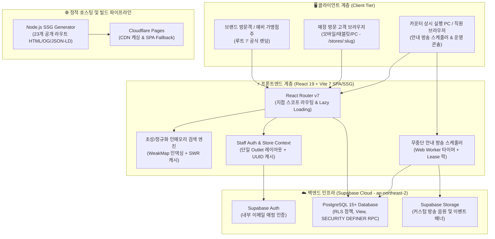
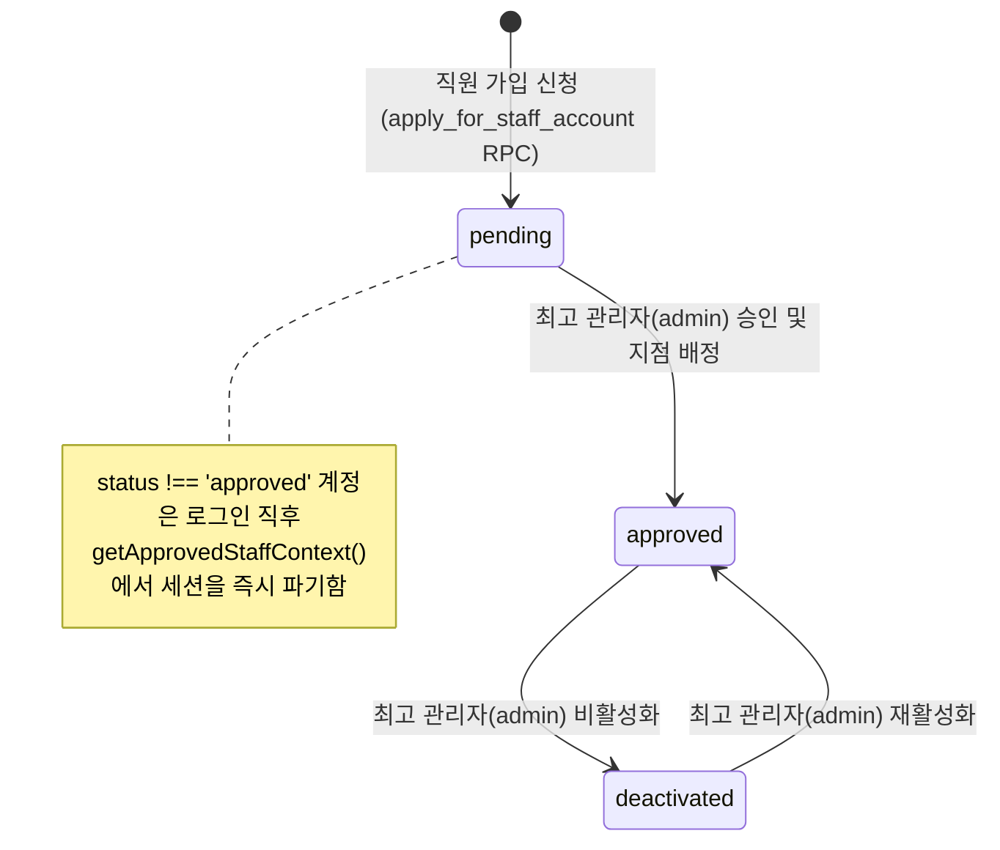

# 시스템 아키텍처 및 인프라 명세 (System Architecture & Infrastructure)

본 문서는 카툰플러스(CartoonPlus) 서비스의 전체 시스템 구조, 기술 스택, 빌드·번들링 파이프라인, SSG 배포 구조 및 보안·데이터 격리 아키텍처를 정의하는 기준 문서임.

---

## 1. 시스템 전체 구성도 (High-Level Architecture)

카툰플러스는 Cloudflare Pages 정적 호스팅(SPA + SSG) 프론트엔드와 Supabase 기반 BaaS(Backend as a Service) 아키텍처로 구성됨.

---

## 2. 기술 스택 명세 (Tech Stack)

| 구분                  | 기술 / 라이브러리                     |        버전         | 적용 목적 및 아키텍처 역할                                                        |
| :-------------------- | :------------------------------------ | :-----------------: | :-------------------------------------------------------------------------------- |
| **Frontend Core**     | `React`, `TypeScript`                 | `^19.1.1`, `~5.9.2` | 컴포넌트 기반 UI 렌더링 및 정적 타입 무결성 보장                                  |
| **Build & Bundler**   | `Vite` + `scripts/generate-ssg.js`    |      `^7.1.5`       | ESModule 고속 번들링, `manualChunks` 분리, 23개 라우트 정적 HTML 생성             |
| **Routing**           | `React Router` (`react-router-dom`)   |      `^7.18.3`      | 브랜드 랜딩(`/`), 고객 지점 포털(`/stores/:slug`), 직원 콘솔(`/staff/:slug`) 제어 |
| **Styling**           | Semantic Vanilla CSS                  |          -          | 외부 CSS 프레임워크 런타임 없이 `src/styles.css` 및 `brandLanding.css` 분리 구성  |
| **Backend & DB**      | `Supabase` (`@supabase/supabase-js`)  |      `^2.57.4`      | PostgreSQL 15+, Row Level Security(RLS), Stored Procedure(RPC), Realtime 구독     |
| **Testing**           | `Vitest`, `@testing-library/react`    | `^3.2.4`, `^16.3.0` | 25개 스위트 / 141개 단위·통합 테스트 검증                                         |
| **Audio / Broadcast** | `HTMLAudioElement`, Inline Web Worker |          -          | 백그라운드 탭 감속 없는 10초 주기 스케줄 판정 및 정적/업로드 MP3 재생             |

---

## 3. 빌드·번들링 및 SSG 배포 아키텍처

### 3.1 Rollup 청크 분리 (`vite.config.ts`)

초기 진입 시 불필요한 코드 다운로드를 방지하기 위해 [vite.config.ts](file:///Users/jaehee/Desktop/projects/cartoonplus/vite.config.ts)에서 `manualChunks`와 [src/App.tsx](file:///Users/jaehee/Desktop/projects/cartoonplus/src/App.tsx)의 `React.lazy`를 결합함.

| 청크 명칭            | 포함 모듈 범위                                                                                                    | 로드 시점                    | 프로덕션 크기 (gzip) |
| :------------------- | :---------------------------------------------------------------------------------------------------------------- | :--------------------------- | :------------------: |
| `index` (엔트리)     | `App.tsx`, `main.tsx`, 도서 검색 코어, 공통 레이아웃                                                              | 최초 진입 시                 | 31.76 kB (10.67 kB)  |
| `vendor-react`       | `react`, `react-dom`, `react-router-dom`                                                                          | 최초 진입 시 (장기 캐싱)     | 91.50 kB (30.57 kB)  |
| `supabase`           | `@supabase/supabase-js`                                                                                           | 최초 진입 시 (장기 캐싱)     | 172.81 kB (44.84 kB) |
| `brand-landing`      | [BrandLandingPage.tsx](file:///Users/jaehee/Desktop/projects/cartoonplus/src/features/brand/BrandLandingPage.tsx) | 루트(`/`) 진입 시            | 55.69 kB (13.34 kB)  |
| `customer-pages`     | 메뉴, 매장소개, 신간, 게임/이벤트/매장정보 페이지                                                                 | 고객 포털 서브탭 진입 시     | 51.31 kB (13.86 kB)  |
| `staff-*` (9개 청크) | 직원 로그인, 대시보드, 재고, 입고, 방송, 계정 등                                                                  | `/staff/*` 진입 시 지연 로드 |   각 2.2 ~ 24.4 kB   |

### 3.2 Node.js 기반 23개 라우트 SSG 파이프라인 (`scripts/generate-ssg.js`)

- 헤드리스 브라우저(`Puppeteer` 등) 의존성 없이 순수 Node.js `fs` 모듈로 빌드 직후 `dist/index.html` 템플릿에 라우트별 고유 `<title>`, `<meta name="description">`, Open Graph, Canonical URL, JSON-LD(`ComicStore`, `WebSite`), 정적 스켈레톤 마크업을 주입함 ([ADR-0004](file:///Users/jaehee/Desktop/projects/cartoonplus/docs/adr/0004-ssg-and-history-api-for-seo.md)).
- **사전 생성 대상 (총 23개 라우트)**:
  - 루트 및 기본 경로(8개): `/`, `/books`, `/about`, `/menu`, `/new-arrivals`, `/games`, `/events`, `/store`
  - 지점별 스코프 경로(15개): `/stores/{snu,jamsil,hongdae}` 및 각 지점 하위 `/about`, `/menu`, `/games`, `/events`
- 빌드 완료 시 `dist/sitemap.xml`, `dist/robots.txt`, `dist/_routes.json`, `dist/404.html`을 함께 생성함.

### 3.3 환경 변수 명세 (`.env.local`)

[src/lib/supabase.ts](file:///Users/jaehee/Desktop/projects/cartoonplus/src/lib/supabase.ts)에서 참조하는 클라이언트 환경 변수는 아래와 같음.

| 환경 변수명                     |      필수 여부       | 용도 및 폴백 동작                                                                                          |
| :------------------------------ | :------------------: | :--------------------------------------------------------------------------------------------------------- |
| `VITE_SUPABASE_URL`             | 선택 (프로덕션 필수) | Supabase 프로젝트 엔드포인트 URL                                                                           |
| `VITE_SUPABASE_PUBLISHABLE_KEY` | 선택 (프로덕션 필수) | Supabase Publishable(Anon) API Key (미설정 시 `supabase = null`로 초기화되어 정적 JSON 폴백 모드로 동작함) |

---

## 4. 보안 및 인증 아키텍처 (Security & Authorization)

### 4.1 내부 이메일 매핑 인증 (`staffIdentity.ts`)

- 매장 직원이 이메일 주소 없이 간단한 로그인 아이디(`login_id`)만으로 로그인할 수 있도록 [src/lib/staffIdentity.ts](file:///Users/jaehee/Desktop/projects/cartoonplus/src/lib/staffIdentity.ts)에서 내부 도메인 이메일(`{loginId}@staff.cartoonplus.local`)로 투명 변환하여 Supabase Auth에 전달함 ([ADR-0003](file:///Users/jaehee/Desktop/projects/cartoonplus/docs/adr/0003-virtual-email-mapping-for-staff-auth.md)).

### 4.2 직원 계정 상태 머신 및 권한 검증

### 4.3 Row Level Security (RLS) 권한 매트릭스

| 데이터 영역                                   |                                                                     비로그인 고객 (`anon`)                                                                      |      일반 직원 (`staff`)      |          최고 관리자 (`admin`)           |
| :-------------------------------------------- | :-------------------------------------------------------------------------------------------------------------------------------------------------------------: | :---------------------------: | :--------------------------------------: |
| **도서 카탈로그 (`customer_book_catalogue`)** |                                                                            `SELECT`                                                                             |           `SELECT`            |                 `SELECT`                 |
| **도서 재고 (`book_inventory`)**              |                                                                            `SELECT`                                                                             |  소속 `store_id` 한정 `ALL`   |              전 지점 `ALL`               |
| **도서 입고 신청 (`book_requests`)**          |                                                                       `SELECT`, `INSERT`                                                                        | 소속 `store_id` 한정 `UPDATE` |        전 지점 `UPDATE`, `DELETE`        |
| **매장 콘텐츠·이벤트·게임**                   |                                                                       공개 항목 `SELECT`                                                                        |  소속 `store_id` 한정 `ALL`   |              전 지점 `ALL`               |
| **안내 방송 프리셋·스케줄·실행이력**          | 카운터 스케줄 조회·이력 기록 허용 ([ADR-0010](file:///Users/jaehee/Desktop/projects/cartoonplus/docs/adr/0010-unauthenticated-broadcast-and-7day-retention.md)) |  소속 `store_id` 한정 `ALL`   |              전 지점 `ALL`               |
| **직원 계정 (`staff_accounts`)**              |                                                                    가입 신청 RPC 호출만 허용                                                                    |     본인 레코드 `SELECT`      | 전 계정 승인·비활성화·임시 비밀번호 발급 |

---

## 5. 클라이언트 성능 및 캐싱 아키텍처

1. **도서 카탈로그 SWR 인메모리 캐시 (`catalogueMemoryCache`)**:
   - [src/App.tsx](file:///Users/jaehee/Desktop/projects/cartoonplus/src/App.tsx)의 `BooksRoute`에서 지점별 도서 목록을 `Map<StoreSlug, SearchableBook[]>`에 캐싱하여 탭 왕복 시 로딩 스피너 깜빡임 없이 즉시 렌더링하고 백그라운드에서 재검증함.
2. **도서 검색 `WeakMap` 사전 인덱싱 (`bookSearch.ts`)**:
   - [src/lib/bookSearch.ts](file:///Users/jaehee/Desktop/projects/cartoonplus/src/lib/bookSearch.ts)에서 도서 객체별 정규화 문자열과 초성 인덱스를 `WeakMap<SearchableBook, IndexedBookFields>`에 1회만 생성·재사용하여 검색 시 문자열 재계산 비용을 제거함.
3. **단일 레이아웃 마운트 및 지점 UUID 캐싱 (`StaffStoreContext.tsx`)**:
   - `/staff/:storeSlug/*` 하위 라우트를 단일 `<ProtectedStaffRoute />`(`<Outlet />`)로 감싸고, `resolveStoreIdBySlug` 결과를 인메모리 `Map`에 캐싱하여 직원 페이지 이동 시 중복 인증·지점 조회 쿼리를 제거함.
4. **백그라운드 무감속 방송 타이머 (`broadcastRunner.ts`)**:
   - 브라우저 백그라운드 탭의 `setInterval` 스로틀링(1분 이상 지연)을 우회하기 위해 인라인 Blob Web Worker에서 10초 주기 틱을 발생시키고, 스케줄 목록은 60초 TTL 인메모리 캐시 및 Realtime 이벤트로 동기화함.
