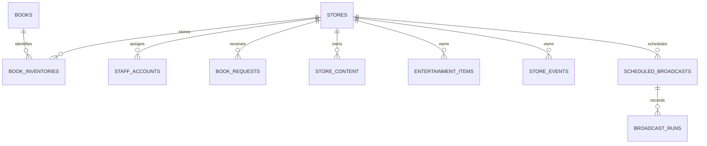

# 카툰플러스 데이터 모델 (Data Model & Schema)

## 1. 기준과 범위

- 본 문서는 카툰플러스 운영 데이터베이스의 표준 기준 문서임.
- 실제 데이터베이스 스키마의 물리적 기준은 `supabase/migrations/`이며, 본 문서는 최신 마이그레이션(ADR-0001 ~ ADR-0010) 내역을 체계적으로 요약함.
- **서울대입구역점(`snu`)**, **잠실점(`jamsil`)**, **홍대점(`hongdae`)** 3개 지점의 다지점 운영을 전면 지원하며, 지점별 URL 컨텍스트(`store_id`) 및 Supabase Row Level Security(RLS)를 통한 데이터 격리를 보장함.

---

## 2. 핵심 엔티티 관계도 (ERD)

---

## 3. 테이블 명세 (Tables Specification)

| 테이블                      | 목적                               | 핵심 식별자 및 제약조건                                                                                                                                      | 비고                                               |
| :-------------------------- | :--------------------------------- | :----------------------------------------------------------------------------------------------------------------------------------------------------------- | :------------------------------------------------- |
| `stores`                    | 매장 마스터 정보                   | UUID `id` (PK), `slug` (고유, `snu`/`jamsil`/`hongdae`), `name`                                                                                              | 3개 지점 운영                                      |
| `books`                     | 지점 독립적 공통 도서 메타데이터   | `(title, author)` 복합 고유, `normalized_title`, `initial_consonants` (초성 검색용), `archived_at`                                                           | 지점 간 공유 도서 카탈로그                         |
| `book_inventories`          | 지점별 도서 보유 권수 및 서가 위치 | `(store_id, book_id)` 복합 고유 (PK), `volume_range`, `last_volume`, `shelf_location`, `first_registered_at`                                                 | 도서 삭제 시 영구 삭제 처리 (복구 미지원)          |
| `staff_accounts`            | Supabase Auth 연동 직원 프로필     | `id` (FK `auth.users(id)`), `login_id` (고유), `store_id` (FK), `role` (`staff`/`admin`), `status` (`pending`/`approved`/`deactivated`), `phone_last_digits` | 이메일 미수집, 승인제 운영                         |
| `book_requests`             | 고객 비회원 희망도서 입고 신청     | `id` (PK), `store_id` (NOT NULL FK), `title`, `author`, `genre`, `memo`, `status` (`received`/`ordered`/`completed`/`unavailable`)                           | 고객 개인정보 일체 미수집                          |
| `store_content`             | 지점별 메뉴, 요금제 및 시설 정보   | `(store_id, content_key)` 복합 고유 (PK), `content_data` (JSONB: `price_packages`, `beverage_items`, `food_items`, `store_info`)                             | 지점별 인라인 편집 지원                            |
| `entertainment_items`       | 게임 팩 및 보드게임 카탈로그       | `(store_id, item_type, title)` 복합 고유, `quantity`, `is_verified` (실물 검증 여부)                                                                         | 미검증 시 고객 화면 '점검 중' 처리                 |
| `store_events`              | 매장 진행 이벤트                   | `(store_id, title)` 복합 고유, `is_published`, `is_always`, `start_date`, `end_date`, `badge_text`, `image_url`                                              | 종료일 익일 자동 숨김 처리                         |
| `broadcast_presets`         | 안내 방송 음원 및 프리셋 문구      | `id` (PK), `store_id` (Nullable FK, NULL 시 전 지점 공통), `source_type` (`static`/`upload`), `audio_url`, `hidden_at`                                       | 6종 정적 음원 및 3MB 이하 커스텀 음성              |
| `scheduled_broadcasts`      | 정기/일회성 안내 방송 스케줄       | `id` (PK), `store_id` (FK), `preset_id` (FK), `schedule_type` (`daily`/`weekly`/`once`), `time_of_day`, `days_of_week`, `is_active`                          | 비로그인 카운터 PC에서도 스케줄 평가               |
| `broadcast_runs`            | 안내 방송 실행 감사 로그           | `id` (PK), `scheduled_broadcast_id` (Nullable FK), `store_id` (FK), `status` (`pending`/`success`/`failure`/`missed`/`cancelled`), `triggered_at`            | 7일 롤링 보존 (트리거로 7일 경과 레코드 자동 삭제) |
| `broadcast_playback_leases` | 지점별 방송 담당 탭 중복 방지 임대 | `store_id` (PK), `lease_holder_id`, `expires_at` (30초 단위 갱신)                                                                                            | 여러 브라우저 탭 간 중복 송출 방지                 |

---

## 4. 접근 제어 및 보안 정책 (Row Level Security)

PostgreSQL RLS 기반 인가(Authorization) 정책 적용:

1. **고객 (Guest / `anon`)**:
   - 도서 카탈로그(`books`, `book_inventories`), 검증 완료 게임(`entertainment_items`), 공개 이벤트(`store_events`), 메뉴/매장 콘텐츠(`store_content`) 조회(SELECT) 가능.
   - 도서 입고 신청(`book_requests`) 등록(INSERT) 가능 (개인정보 미수집).
   - 비로그인 안내 방송 송출 지원을 위한 `broadcast_presets`, `scheduled_broadcasts` 조회 및 `broadcast_playback_leases`, `broadcast_runs` RPC/INSERT 허용 ([ADR-0010](docs/adr/0010-unauthenticated-broadcast-and-7day-retention.md)).
2. **승인 직원 (Staff / `authenticated` & `approved`)**:
   - 소속 지점(`staff_accounts.store_id`) 데이터 한정 CRUD 권한 부여.
   - 타 지점 데이터 쓰기/수정/삭제 시도 차단.
3. **최고 관리자 (Admin / `role = 'admin'`)**:
   - 전 지점 데이터 통합 관리 권한 보유.
   - 직원 가입 승인/반려, 계정 비활성화, 임시 비밀번호 발급(`admin_reset_staff_password` RPC) 수행.

---

## 5. 지점별 CSV 재고 파싱 및 업서트 규칙

| 지점                       | CSV 포맷 구조                                              | 파싱 및 분리 규칙                                                                                                  |
| :------------------------- | :--------------------------------------------------------- | :----------------------------------------------------------------------------------------------------------------- |
| **서울대입구역점 (`snu`)** | Caspio 표준 포맷 (`title`, `number`, `genre`, `author`) | `title + author` 기준 도서 매칭, `number`에서 권수 범위 추출(`1~N권` 포맷 변환).                                   |
| **잠실점 (`jamsil`)**      | 서가/도서명 묶음 포맷 (`a_`, `a___`)                    | `a___` 컬럼 내 `//` 구분자로 도서 분리, 끝부분 `공백 + 숫자`를 권수로 분리. 모호한 표기는 수동 검토 대상으로 중단. |
| **홍대점 (`hongdae`)**     | 복합 구분자 포맷 (`a_`, `a_1`, `a_2`)                   | `a_` 컬럼에서 `//` 및 단일 `/` 구분자로 개별 도서 분리. 도서명 자체 슬래시/괄호 원문 유지.                         |

- **가져오기 처리 원칙**:
  - `upsert_inventory_for_store` RPC를 통해 호출 직원의 소속 지점 ID 검증 후 배치 반영.
  - 동일 지점·동일 도서 중복 생성 방지(Upsert 처리), CSV 미기재 기존 도서 안전 보존(자동 삭제 방지).

---

## 6. 마이그레이션 관리 원칙

- 신규 스키마 변경 시 `supabase/migrations/` 내 타임스탬프 기반 신규 SQL 파일 추가.
- 배포 완료된 기존 마이그레이션 파일의 임의 수정 및 삭제 금지.
- 데이터 모델 명세서(`docs/DATA_MODEL.md`)와 마이그레이션 스키마의 실시간 정합성 유지.
