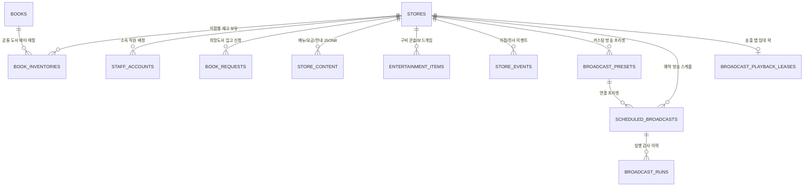

# 카툰플러스 데이터 모델 명세서 (Data Model & Schema)

## 1. 기준과 범위

- 본 문서는 카툰플러스 운영 데이터베이스(Supabase PostgreSQL 15+)의 테이블, 뷰(View), RLS 보안 정책 및 CSV 전처리 규칙을 정의하는 단일 기준 문서임.
- 물리적 스키마의 기준은 `supabase/migrations/` 디렉터리이며, 본 문서는 실제 애플리케이션 쿼리 코드와 1:1 정합성을 유지함.
- **서울대입구역점(`snu`)**, **잠실점(`jamsil`)**, **홍대점(`hongdae`)** 3개 직영 지점의 데이터 격리(`store_id`) 및 공유 마스터(`books`) 구조를 지원함.

---

## 2. 핵심 엔티티 관계도 (ERD)

---

## 3. 테이블 및 뷰(View) 상세 명세

### 3.1 물리 테이블 명세 (Tables Specification)

| 테이블명                    | 목적 및 역할                       | 주요 컬럼 및 제약조건 (실제 쿼리 기준)                                                                                                                                                                                                          | 운영 정책 및 비고                                                                                                                                                           |
| :-------------------------- | :--------------------------------- | :---------------------------------------------------------------------------------------------------------------------------------------------------------------------------------------------------------------------------------------------- | :-------------------------------------------------------------------------------------------------------------------------------------------------------------------------- |
| `stores`                    | 직영 매장 마스터                   | `id` (UUID PK), `slug` (UNIQUE: `'snu'`, `'jamsil'`, `'hongdae'`), `name`                                                                                                                                                                       | 클라이언트에서 슬러그-UUID 인메모리 캐싱 적용                                                                                                                               |
| `books`                     | 전 지점 공통 도서 메타데이터       | `id` (UUID PK), `title`, `author`, `publisher`, `category` (11대 표준 장르), `normalized_title`, `initial_consonants`, `archived_at` • 고유 인덱스: `books_title_author_idx (title, author)`                                                | 지점 간 도서 메타 공유, 수정 시 타 지점 참조 여부에 따라 안전 재지정(Re-point)                                                                                              |
| `book_inventories`          | 지점별 도서 보유 권수 및 서가 위치 | `id` (UUID PK), `store_id` (FK), `book_id` (FK), `volume_range` (예: `'1~35권'`), `last_volume` (INT), `shelf_location`, `note`, `first_registered_at`, `updated_at` • 복합 고유: `(store_id, book_id)`                                     | 재고 삭제 시 소속 지점 행만 영구 삭제 (`first_registered_at` 기준 30일간 신간 판정)                                                                                         |
| `staff_accounts`            | Supabase Auth 연동 직원 프로필     | `id` (PK, `auth.users` FK), `store_id` (FK), `login_id` (UNIQUE), `name`, `phone_last4`, `role` (`'staff'` \| `'admin'`), `status` (`'pending'` \| `'approved'` \| `'deactivated'`)                                                             | 개인 이메일 미수집 (`{login_id}@cartoonplus.internal` 내부 매핑), 관리자 승인제                                                                                             |
| `book_requests`             | 비회원 희망도서 입고 신청          | `id` (UUID PK), `store_id` (FK), `title`, `author`, `desired_volume`, `customer_comment`, `status` (`'received'` \| `'ordered'` \| `'completed'` \| `'unavailable'`), `staff_note`, `created_at`, `updated_at`                                  | 고객 개인정보(이름·연락처) 일체 미수집                                                                                                                                      |
| `store_content`             | 지점별 요금제·식음료·시설 안내     | `id` (UUID PK), `store_id` (FK), `content_key` (`'price_packages'` \| `'beverage_items'` \| `'food_items'` \| `'store_info'`), `content_value` (JSONB), `updated_at` • 복합 고유: `(store_id, content_key)`                                 | 지점별 인라인 편집 및 정적 기본값([menuData.ts](file:///Users/jaehee/Desktop/projects/cartoonplus/src/features/customer/menuData.ts)) 폴백 지원                             |
| `entertainment_items`       | 콘솔 게임 팩 및 보드게임 카탈로그  | `id` (UUID PK), `store_id` (FK), `item_type` (`'nintendo'` \| `'playstation_4'` \| `'xbox'` \| `'board_game'`), `title`, `players`, `genre`, `quantity`, `is_available`, `is_verified`                                                          | 현장 실물 검증(`is_verified`) 완료 지점만 고객 화면 노출                                                                                                                    |
| `store_events`              | 매장 진행 이벤트                   | `id` (UUID PK), `store_id` (Nullable FK), `store_slug` (`'snu'` \| `'jamsil'` \| `'hongdae'` \| `'all'`), `title`, `content`, `tag`, `target`, `banner_type`, `image_url`, `start_date`, `end_date`, `is_always_on`, `is_featured`, `is_public` | 종료일(`end_date`) 익일 고객 화면에서 자동 숨김 처리                                                                                                                        |
| `broadcast_presets`         | 안내 방송 음원 및 대본 프리셋      | `id` (UUID PK), `store_id` (Nullable FK, NULL 시 전 지점 기본 프리셋), `preset_key`, `title`, `category`, `script`, `source_type` (`'static'` \| `'upload'`), `audio_url`, `hidden_at`, `sort_order`                                            | 6종 기본 정적 음원 및 지점별 3MB 이하 업로드 음원 관리                                                                                                                      |
| `scheduled_broadcasts`      | 정기·일회성 예약 방송 스케줄       | `id` (UUID PK), `store_id` (FK), `broadcast_preset_id` (Nullable FK), `title`, `message`, `schedule_type` (`'daily'` \| `'weekly'` \| `'once'`), `target_time` (`HH:mm`), `target_days` (INT[]), `target_date`, `is_enabled`                    | 수신기 등록된 카운터 PC에서 비로그인 상태로 스케줄 평가                                                                                                                     |
| `broadcast_runs`            | 안내 방송 실행 감사 로그           | `id` (UUID PK), `store_id` (FK), `scheduled_broadcast_id` (Nullable FK), `message`, `status` (`'pending'` \| `'success'` \| `'failure'` \| `'missed'` \| `'cancelled'`), `executed_at`, `error_message`                                         | 최근 7일 롤링 보존 (7일 경과 레코드 자동 정리, [ADR-0010](file:///Users/jaehee/Desktop/projects/cartoonplus/docs/adr/0010-unauthenticated-broadcast-and-7day-retention.md)) |
| `broadcast_playback_leases` | 지점별 방송 송출 탭 중복 방지 임대 | `store_id` (UUID PK), `holder_id` (탭 식별자), `expires_at` (30초 단위 갱신 타임스탬프)                                                                                                                                                         | 단일 카운터 탭에서만 오디오 송출 보장                                                                                                                                       |

### 3.2 읽기 전용 뷰 명세 (`customer_book_catalogue`)

고객 도서 검색 화면([catalogueRepository.ts](file:///Users/jaehee/Desktop/projects/cartoonplus/src/features/book-search/catalogueRepository.ts))은 다중 조인 오버헤드를 줄이기 위해 `book_inventories`, `books`, `stores`를 결합한 `customer_book_catalogue` 뷰를 `.range(page * 1000, (page + 1) * 1000 - 1)` 페이지네이션으로 조회함.

| 뷰 컬럼명                            | 원본 출처                          | 설명                                            |
| :----------------------------------- | :--------------------------------- | :---------------------------------------------- |
| `inventory_id` / `book_id`           | `book_inventories.id` / `books.id` | 재고 및 도서 마스터 고유 식별자                 |
| `store_slug`                         | `stores.slug`                      | 지점 식별 슬러그 (`snu`, `jamsil`, `hongdae`)   |
| `title` / `author` / `publisher`     | `books`                            | 도서명, 작가명, 출판사                          |
| `category`                           | `books.category`                   | 11대 표준 장르 문자열                           |
| `volume_range` / `last_volume`       | `book_inventories`                 | 보유 권수 표기(예: `1~35권`) 및 최신 권수 정수  |
| `shelf_location`                     | `book_inventories.shelf_location`  | 매장 내 서가 위치(예: `A구역`, `책장 6번`)      |
| `first_registered_at` / `updated_at` | `book_inventories`                 | 최초 입고 등록일(30일 신간 기준) 및 최종 수정일 |

---

## 4. 주요 Stored Procedure (RPC) 명세

| RPC 함수명                       | 호출 주체                    | 주요 수행 로직                                                                                       |
| :------------------------------- | :--------------------------- | :--------------------------------------------------------------------------------------------------- |
| `apply_for_staff_account`        | 신규 가입 신청 직원          | `staff_accounts` 테이블에 `status = 'pending'`, 소속 `store_id`, `login_id`, `phone_last4` 등록      |
| `admin_reset_staff_password`     | 최고 관리자 (`admin`)        | 비밀번호 분실 직원의 `auth.users` 암호를 임시 비밀번호로 갱신 (`SECURITY DEFINER`)                   |
| `upsert_inventory_for_store`     | 승인 직원 (`staff`, `admin`) | 지점 권한 검증 후 `(title, author)` 기준 `books` 마스터 생성/매칭 및 `book_inventories` Upsert       |
| `update_inventory_for_store`     | 승인 직원 (`staff`, `admin`) | 기존 재고 수정 시 고유 키 충돌 방지를 위해 타 지점 공유 여부 확인 후 안전 재지정(Re-point) 또는 갱신 |
| `claim_broadcast_playback_lease` | 카운터 방송 수신기 PC        | 지점별 30초 Lease 락 획득·갱신 및 만료된 타 탭 Lease 인수                                            |

---

## 5. 지점별 CSV 재고 파싱 및 업서트 규칙

[src/lib/inventoryCsv.ts](file:///Users/jaehee/Desktop/projects/cartoonplus/src/lib/inventoryCsv.ts) 및 [src/lib/inventoryImport.ts](file:///Users/jaehee/Desktop/projects/cartoonplus/src/lib/inventoryImport.ts)에서 처리하는 지점별 CSV 규격은 아래와 같음.

| 지점                       | 지원 CSV 헤더 포맷                                 | 파싱 및 데이터 정규화 규칙                                                                         |
| :------------------------- | :------------------------------------------------- | :------------------------------------------------------------------------------------------------- |
| **공통 정제 포맷**         | `도서명, 보유권수, 작가, 목표장르, 기존서가` (5열) | 전 지점 표준 백업/정제 포맷으로 각 컬럼을 1:1 매핑하여 즉시 적재함                                 |
| **서울대입구역점 (`snu`)** | Caspio 원본 (`title, number, genre, author`)       | `title` 끝의 숫자를 `1~N권`으로 분리하고 `number`를 `N번 서가`로 변환함                            |
| **잠실점 (`jamsil`)**      | 서가 묶음 원본 (`a_, a___`)                        | `a_`를 서가 번호로, `a___` 내 `//` 구분자 문자열을 개별 도서 및 권수로 분리함                      |
| **홍대점 (`hongdae`)**     | 복합 구분자 원본 (`a_, a_1, a_2`)                  | `a_` 내 `//` 및 단일 `/` 구분자로 도서를 분리하되 제목 고유 슬래시(`1/2`, `Fate/stay` 등)는 보존함 |

- **배치 가져오기 안전 원칙**:
  - 업로드 시 10건 단위 제한 동시성(`CONCURRENCY_LIMIT = 10`)으로 `upsert_inventory_for_store` RPC를 병렬 호출함.
  - CSV에 포함되지 않은 기존 매장 재고는 자동 삭제하지 않고 보존함.
