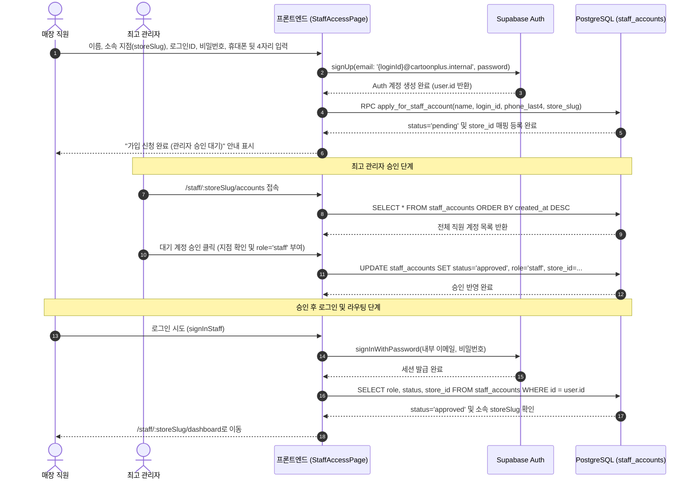
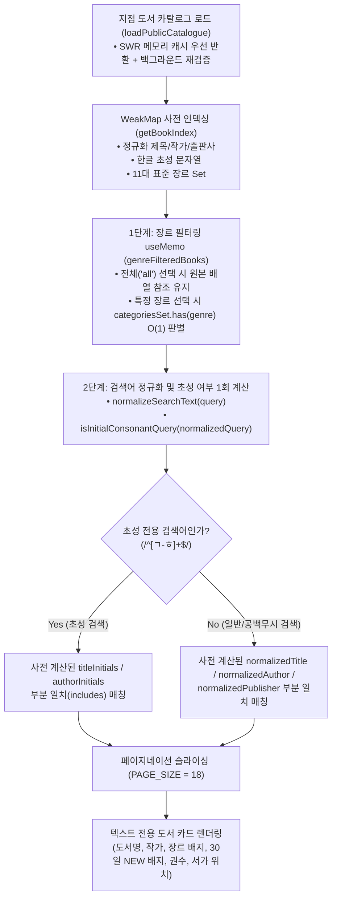
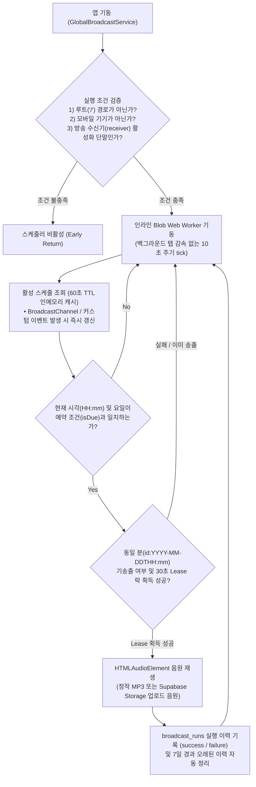
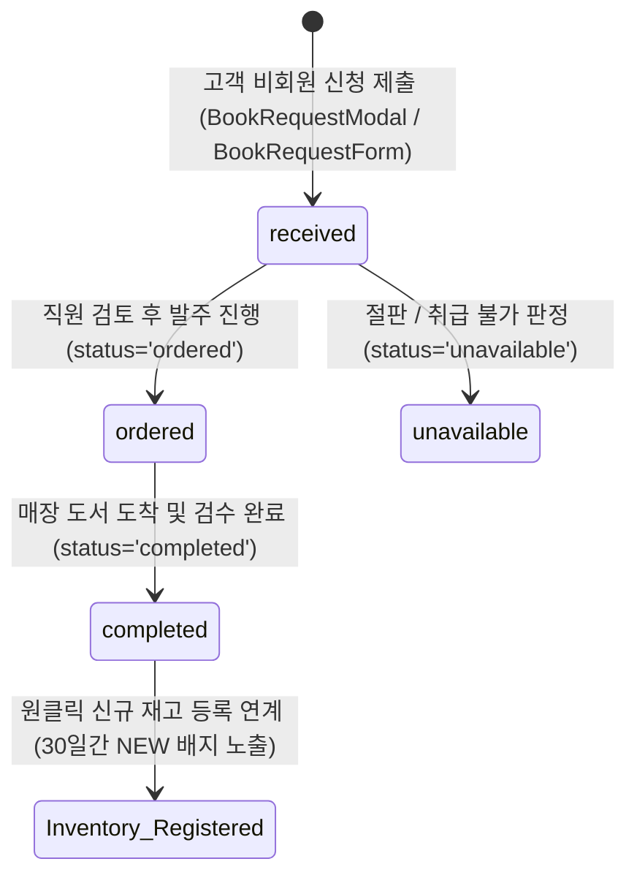

# 주요 기능 실행 흐름 및 시나리오 (Flows & Scenarios)

본 문서는 카툰플러스(CartoonPlus)의 핵심 비즈니스 흐름과 클라이언트·서버 간 실행 시퀀스를 다이어그램 및 개조식 명세로 정의한 기준 문서임.

---

## 1. 직원 가입 신청 및 관리자 승인 흐름 (Staff Auth Flow)

매장 직원은 개인 이메일 대신 로그인 아이디(`login_id`)를 사용하며, 최고 관리자(`admin`)의 승인을 거친 후 소속 지점 콘솔에 접근함.

### 1.1 시퀀스 다이어그램

### 1.2 예외 및 보안 처리 규칙

- `status`가 `'pending'` 또는 `'deactivated'`인 계정이 로그인을 시도할 경우, [src/features/staff/staffAuth.ts](file:///Users/jaehee/Desktop/projects/cartoonplus/src/features/staff/staffAuth.ts)에서 즉시 `supabase.auth.signOut()`을 호출하여 세션을 파기하고 접근 거부 안내를 표시함.
- 일반 직원(`role === 'staff'`)이 URL을 직접 조작하여 타 지점 경로(`/staff/other-slug/*`)에 접근할 경우, [src/App.tsx](file:///Users/jaehee/Desktop/projects/cartoonplus/src/App.tsx)의 `ProtectedStaffRoute`에서 본인 소속 지점 경로로 강제 리다이렉트함.

---

## 2. 한글 초성 및 공백 무시 도서 검색 흐름 (Book Search Flow)

지점당 수천~수만 권의 도서 데이터를 키 입력마다 지연 없이 필터링하기 위해 [src/lib/bookSearch.ts](file:///Users/jaehee/Desktop/projects/cartoonplus/src/lib/bookSearch.ts)의 `WeakMap` 사전 인덱싱과 [src/features/book-search/BookSearchPage.tsx](file:///Users/jaehee/Desktop/projects/cartoonplus/src/features/book-search/BookSearchPage.tsx)의 2단계 분리형 `useMemo` 파이프라인을 적용함.

### 2.1 검색 파이프라인 다이어그램

### 2.2 핵심 알고리즘 명세 (`bookSearch.ts`)

- **유니코드 한글 초성 추출**: 한글 음절 범위(`0xAC00` ~ `0xD7A3`)에 대해 `Math.floor((code - 0xAC00) / 588)` 공식으로 19개 초성 인덱스를 $O(L)$에 추출함.
- **공백 및 특수문자 제거 정규화**: `text.toLowerCase().replace(/[\s\p{P}\p{S}]/gu, '')`를 적용하여 띄어쓰기나 문장부호 차이를 무시함.
- **무효 쿼리 거부**: 정규화 결과가 빈 문자열이면서 원본 입력이 공백/특수문자뿐인 경우 `false`를 반환하여 불필요한 전체 목록 노출을 차단함.

---

## 3. 매장 자동 안내 방송 및 스케줄러 흐름 (Broadcast Flow)

매장 앰프 스피커에 연결된 카운터 PC에서 비로그인 상태 및 백그라운드 탭 환경에서도 정시에 안내 방송을 송출하기 위해 [src/lib/broadcastRunner.ts](file:///Users/jaehee/Desktop/projects/cartoonplus/src/lib/broadcastRunner.ts) 기반 아키텍처를 구동함.

### 3.1 자동 방송 실행 흐름도

### 3.2 다중 단말 간섭 방지 및 동기화 규칙

1. **명시적 수신기 등록 (`cartoonplus_broadcast_receiver_enabled`)**: 매장 내 도서 검색용 PC나 태블릿에서 안내 방송이 울리는 것을 방지하기 위해, 카운터 앰프 PC에서만 수신기 토글을 `ON`으로 설정함.
2. **다중 탭 즉시 동기화 (`BroadcastChannel`)**: 직원이 관리 화면(`/staff/:storeSlug/broadcast`)에서 예약을 추가·수정·비활성화하면 `BroadcastChannel('cartoonplus_broadcast_channel')`을 통해 동일 브라우저의 모든 탭 캐시를 즉시 무효화함.

---

## 4. 도서 입고 신청 및 재고 등록 연계 흐름 (Book Request & CSV Import Flow)

### 4.1 비회원 도서 입고 신청 상태 다이어그램

### 4.2 지점별 CSV 배치 재고 동기화 흐름 (`inventoryImport.ts`)

1. **지점 식별 검증**: 업로드한 CSV 파일명에 포함된 지점 식별자와 현재 선택된 지점(`storeSlug`)이 일치하는지 사전 검증하여 타 지점 오업로드를 차단함.
2. **인코딩 및 포맷 자동 파싱**: UTF-8 및 EUC-KR/CP949 인코딩을 자동 감지하고 지점별 헤더 규격(`snu`, `jamsil`, `hongdae`, 표준 5열)을 파싱함.
3. **10건 단위 배치 병렬 Upsert**: `CONCURRENCY_LIMIT = 10` 워커 풀을 통해 `upsert_inventory_for_store` RPC를 병렬 호출하여 대량 재고 동기화 시간을 단축함.
