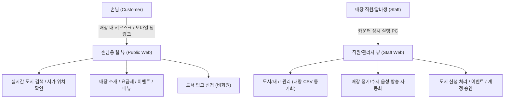
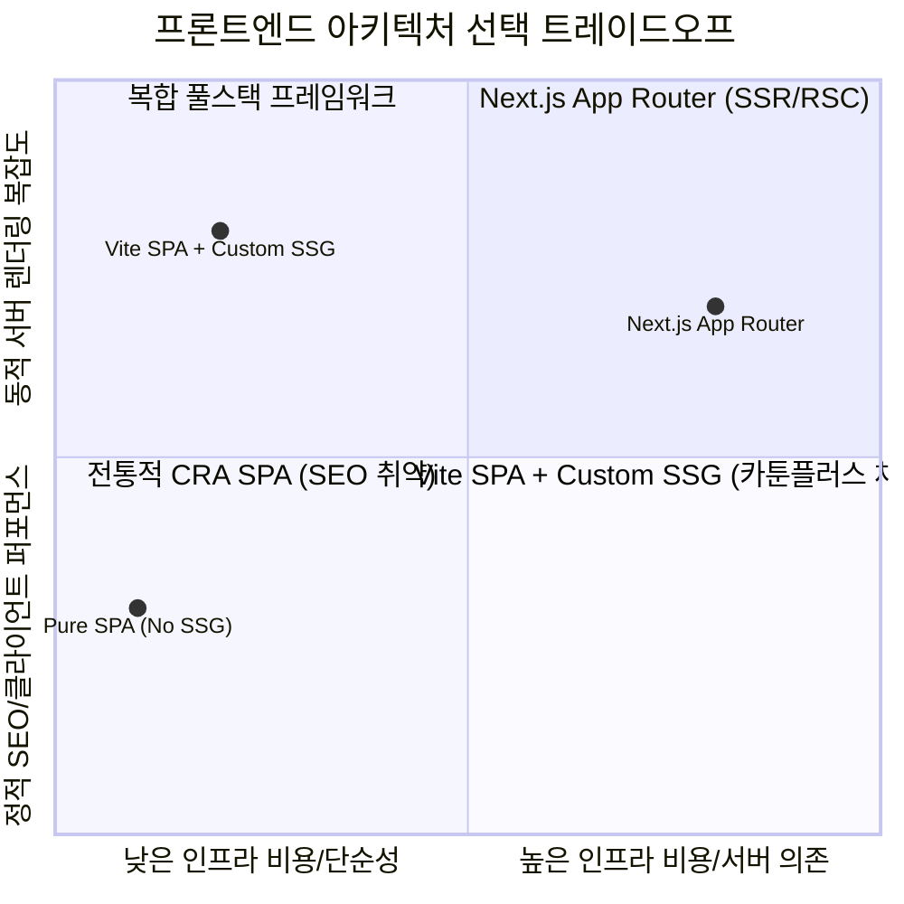
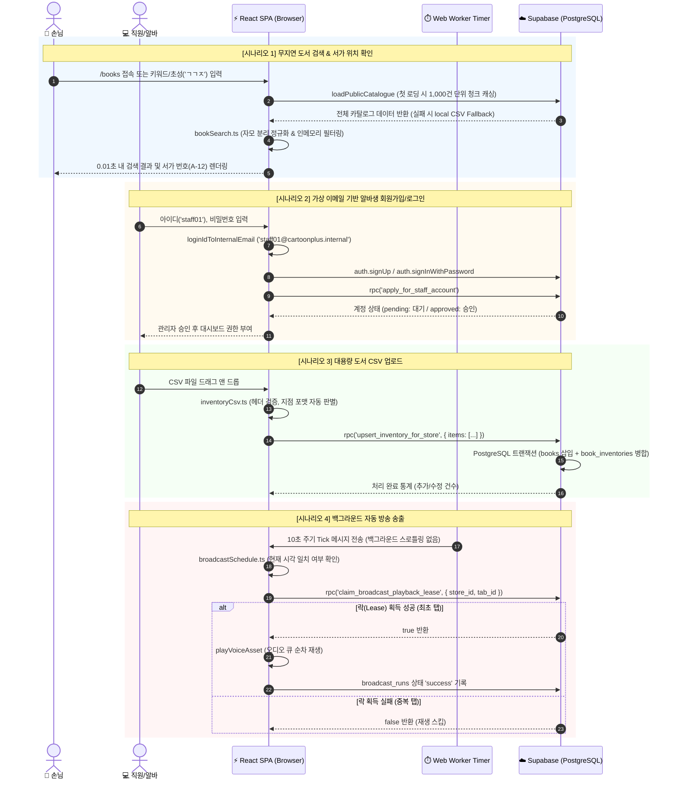
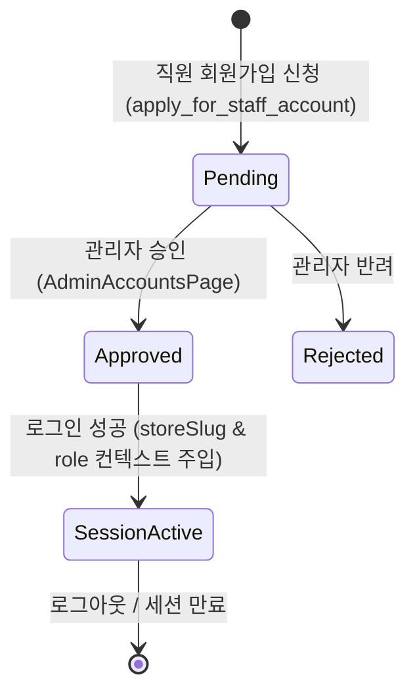
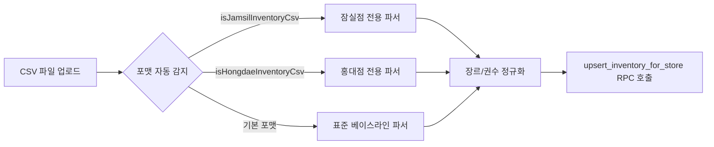

# 카툰플러스(CartoonPlus) 아키텍처 & 코드 심층 학습 가이드 (Learning Guide)

본 문서는 **카툰플러스(CartoonPlus)** 프로젝트의 전체 시스템 설계 의도, 기술적 의사결정(ADR) 배경, 핵심 비즈니스 로직의 코드 레벨 구현 원리 및 엔지니어링 베스트 프랙티스를 체계적으로 정리한 마스터 학습 가이드입니다. 신규 온보딩 엔지니어부터 아키텍트까지 본 문서를 통해 코드베이스를 깊이 있게 파악할 수 있습니다.

---

## 목차 (Table of Contents)

1. [프로젝트 개요 및 도메인 컨텍스트](#1-프로젝트-개요-및-도메인-컨텍스트)
2. [기술 스택 선정 배경 및 아키텍처적 트레이드오프](#2-기술-스택-선정-배경-및-아키텍처적-트레이드오프)
3. [시스템 아키텍처 및 E2E 데이터 흐름](#3-시스템-아키텍처-및-e2e-데이터-흐름)
4. [핵심 모듈 심층 코드 분석](#4-핵심-모듈-심층-코드-분석)
   - 4.1. [초성 검색 및 대용량 인메모리 카탈로그 엔진](#41-초성-검색-및-대용량-인메모리-카탈로그-엔진)
   - 4.2. [가상 이메일 매핑 인증 및 RLS 보안 라이프사이클](#42-가상-이메일-매핑-인증-및-rls-보안-라이프사이클)
   - 4.3. [Web Worker 기반 정밀 방송 스케줄러 & 분산 락(Lease)](#43-web-worker-기반-정밀-방송-스케줄러--분산-락lease)
   - 4.4. [대용량 인벤토리 동기화 및 원자적 RPC 파이프라인](#44-대용량-인벤토리-동기화-및-원자적-rpc-파이프라인)
   - 4.5. [멀티 스토어 컨텍스트 및 SEO 최적화 정적 사이트 생성(SSG)](#45-멀티-스토어-컨텍스트-및-seo-최적화-정적-사이트-생성ssg)
5. [설계 패턴 및 엔지니어링 베스트 프랙티스](#5-설계-패턴-및-엔지니어링-베스트-프랙티스)
6. [온보딩 및 디버깅 가이드 (Troubleshooting)](#6-온보딩-및-디버깅-가이드-troubleshooting)

---

## 1. 프로젝트 개요 및 도메인 컨텍스트

### 1.1. 비즈니스 모델 및 도메인 문제 정의

카툰플러스는 복합 문화 공간(만화카페, OTT 룸, 콘솔 게임, 라면 바)을 운영하는 오프라인 매장을 위한 온·오프라인 결합(O2O) 웹 플랫폼입니다. 현재 **서울대입구역점(`snu`)**, **잠실점(`jamsil`)**, **홍대점(`hongdae`)** 등 복수 지점을 단일 시스템에서 통합 운영합니다.



### 1.2. 클라이언트 이원화 요구사항

1. **손님용 웹 (Customer View)**:
   - 인증 없이 즉시 3,000~10,000권 이상의 만화책 서가 위치를 0.1초 내 초성/키워드로 무지연 검색할 수 있어야 함.
   - 포털 검색(SEO) 및 지점별 딥링크(`/stores/:slug`)를 지원해야 함.
2. **직원/관리자용 웹 (Staff/Admin View)**:
   - 알바생 교체가 잦은 매장 특성상 복잡한 이메일 인증 대신 단순 아이디(`loginId`)로 가입/로그인.
   - 카운터 PC 브라우저가 백그라운드에 최소화되어 있어도 정해진 시간(영업 종료 안내, 매장 에티켓 등)에 음성 방송이 누락 없이 자동 송출되어야 함.
   - 복수 탭 실행 시 동일 방송이 중복 재생되는 하울링 방지.

---

## 2. 기술 스택 선정 배경 및 아키텍처적 트레이드오프

### 2.1. 실제 기술 스택 구성

| 레이어            | 선정 기술                                       | 주된 역할 및 선정 사유                                       |
| :---------------- | :---------------------------------------------- | :----------------------------------------------------------- |
| **Frontend UI**   | **React 19, TypeScript**                        | 최신 컴포넌트 라이프사이클 및 엄격한 타입 안정성             |
| **Bundler & Dev** | **Vite 7**                                      | 초고속 HMR 및 최소 번들 오버헤드                             |
| **Routing**       | **React Router v7**                             | 선언적 SPA 라우팅 및 URL 파라미터/쿼리 동기화                |
| **Styling**       | **Custom Semantic CSS (`styles.css`)**          | 디자인 시스템 토큰(CSS 변수) 기반 경량화, 빌드 도구 무의존성 |
| **Backend / DB**  | **Supabase (PostgreSQL 15+)**                   | Serverless BaaS, 행 단위 보안(RLS), Stored Procedures(RPC)   |
| **SEO / SSG**     | **Custom Node SSG (`scripts/generate-ssg.js`)** | 빌드 시점 20개 공개 경로 사전 HTML/OG 메타 생성              |
| **Testing**       | **Vitest, Testing Library**                     | TDD 기반 핵심 비즈니스 로직 및 컴포넌트 검증                 |

---

### 2.2. 프레임워크 및 아키텍처 트레이드오프 분석



#### ① Next.js App Router vs Vite SPA + Custom SSG Generator

- **Next.js App Router를 선택하지 않은 이유**:
  - Node.js 서버 호스팅 비용(Vercel Pro/AWS ECS)이 발생하며, 콜드 스타트 지연 문제가 있음.
  - 매장 카운터 PC에서 24시간 브라우저 탭을 열어두고 Web Worker, AudioContext, 다중 탭 동기화를 수행하는 SPA 환경에는 Node 런타임 서버 렌더링보다 순수 클라이언트 SPA가 훨씬 안정적임.
- **Vite SPA + Custom SSG Generator 채택 이점**:
  - Cloudflare Pages / GitHub Pages 등 **완전 무료 정적 호스팅** 가능.
  - 빌드 타임에 `scripts/generate-ssg.js`를 구동하여 20여 개 지점/페이지별 정적 `index.html`과 `sitemap.xml`, `robots.txt`를 생성함으로써 **검색엔진 크롤링(SEO) 및 OpenGraph 썸네일 노출을 100% 충족**.

#### ② Tailwind CSS vs Pure Semantic CSS (`styles.css`)

- **Pure Semantic CSS 채택 이점**:
  - CSS Custom Properties(`--color-primary`, `--radius-md`, `--space-4`)를 루트에 정의하여 일관된 테마 시스템 구축.
  - 유틸리티 클래스 난립으로 인한 JSX 가독성 저하 방지 및 별도 CSS 파서 플러그인 의존성 제거.

#### ③ Custom Backend vs Supabase BaaS (PostgreSQL + RLS + RPC)

- **Supabase BaaS 채택 이점**:
  - 별도의 Node/Spring 백엔드 API 서버 구축 없이 DB의 **Row-Level Security (RLS)**로 읽기/쓰기 권한을 제어.
  - 복잡한 트랜잭션(대량 인벤토리 Upsert, 계정 승인, 방송 임대 락)은 **PostgreSQL Stored Procedure (RPC)**로 위임하여 네트워크 왕복 비용 최소화 및 데이터 정합성 보장.

---

## 3. 시스템 아키텍처 및 E2E 데이터 흐름

### 3.1. 전체 데이터 흐름 다이어그램



---

## 4. 핵심 모듈 심층 코드 분석

### 4.1. 초성 검색 및 대용량 인메모리 카탈로그 엔진

- **소스 코드**: [`src/lib/bookSearch.ts`](file:///Users/jaehee/Desktop/projects/cartoonplus/src/lib/bookSearch.ts), [`src/features/book-search/catalogueRepository.ts`](file:///Users/jaehee/Desktop/projects/cartoonplus/src/features/book-search/catalogueRepository.ts)

#### 핵심 설계 원리

만화카페 이용자는 키보드로 자모를 완성하지 않고 초성(예: 'ㄱㄱㅈ' ➔ '귀멸의 칼날')이나 띄어쓰기/특수문자가 생략된 단어로 검색하는 경우가 빈번합니다. 매번 DB `ILIKE` 쿼리를 보내면 네트워크 지연(200~500ms)이 발생하므로, 카툰플러스는 **클라이언트 초기 1회 청크 로딩 + 완전 인메모리 자모 분리 검색** 구조를 채택했습니다.

```typescript
// src/lib/bookSearch.ts
const HANGUL_START = 0xac00;
const HANGUL_END = 0xd7a3;
const INITIAL_CONSONANTS = [
  'ㄱ',
  'ㄲ',
  'ㄴ',
  'ㄷ',
  'ㄸ',
  'ㄹ',
  'ㅁ',
  'ㅂ',
  'ㅃ',
  'ㅅ',
  'ㅆ',
  'ㅇ',
  'ㅈ',
  'ㅉ',
  'ㅊ',
  'ㅋ',
  'ㅌ',
  'ㅍ',
  'ㅎ',
];
const INITIAL_CONSONANT_QUERY = /^[ㄱ-ㅎ]+$/;

// 공백, 문장부호, 기호류를 제거하고 소문자로 정규화
export function normalizeSearchText(value: string): string {
  return value.toLowerCase().replace(/[\s\p{P}\p{S}]/gu, '');
}

// 한글 음절 유니코드 연산을 통한 초성 추출 (Unicode Decomposition)
export function toInitialConsonants(value: string): string {
  return [...value]
    .map((character) => {
      const code = character.charCodeAt(0);
      if (code < HANGUL_START || code > HANGUL_END) return character;
      // 한글 음절 공식: 0xAC00 + (초성 × 588) + (중성 × 28) + 종성
      return INITIAL_CONSONANTS[Math.floor((code - HANGUL_START) / 588)];
    })
    .join('');
}
```

#### 무지연 검색 알고리즘 (`searchBooks`)

1. 입력 쿼리가 순수 초성(`/^[ㄱ-ㅎ]+$/`)인 경우 ➔ 도서 제목/작가의 초성 문자열과 매칭.
2. 일반 검색어인 경우 ➔ 정규화된 텍스트(`normalizeSearchText`) 내 포함 여부 매칭.
3. 3,000권 이상의 리스트를 1ms 이내에 필터링하여 사용자 키 입력 즉시 반응.

---

### 4.2. 가상 이메일 매핑 인증 및 RLS 보안 라이프사이클

- **소스 코드**: [`src/lib/staffIdentity.ts`](file:///Users/jaehee/Desktop/projects/cartoonplus/src/lib/staffIdentity.ts), [`src/features/staff/staffAuth.ts`](file:///Users/jaehee/Desktop/projects/cartoonplus/src/features/staff/staffAuth.ts)

#### 핵심 설계 원리

Supabase Auth는 기본적으로 이메일 기반 인증을 요구합니다. 그러나 파트타임 직원이 많은 매장 환경에서 개인 이메일 입력과 확인 메일 수신은 치명적인 UX 장벽입니다. 이를 해결하기 위해 프론트엔드와 DB 계층에서 **투명한 가상 내부 이메일 변환 파이프라인**을 구축했습니다.

```typescript
// src/lib/staffIdentity.ts
export const INTERNAL_STAFF_EMAIL_DOMAIN = '@cartoonplus.internal';

export function loginIdToInternalEmail(loginId: string): string {
  const normalized = loginId.trim().toLowerCase();
  return `${normalized}${INTERNAL_STAFF_EMAIL_DOMAIN}`;
}
```



#### 계정 승인 및 RLS 다중 방어선

1. `applyForStaff`: Supabase Auth 회원가입 후 즉시 `apply_for_staff_account` RPC를 호출하여 `staff_accounts` 테이블에 `status: 'pending'`으로 등록.
2. `signInStaff`: 로그인 성공 후 `staff_accounts.status === 'approved'` 상태인지 검증. 승인되지 않은 계정은 즉시 `auth.signOut()` 처리.
3. **DB RLS (Row-Level Security)**: `staff_accounts` 테이블에 RLS 정책이 걸려 있어, 미승인 사용자는 인벤토리 수정, 방송 등록, 도서 요청 승인 쿼리를 DB 수준에서 거부당함.

---

### 4.3. Web Worker 기반 정밀 방송 스케줄러 & 분산 락(Lease)

- **소스 코드**: [`src/lib/broadcastRunner.ts`](file:///Users/jaehee/Desktop/projects/cartoonplus/src/lib/broadcastRunner.ts), [`src/lib/voiceAssets.ts`](file:///Users/jaehee/Desktop/projects/cartoonplus/src/lib/voiceAssets.ts)

#### 해결한 3대 기술 난제

1. **브라우저 백그라운드 탭 타이머 스로틀링**: Chrome/Safari는 비활성 탭의 `setInterval` 주기를 1분 이상으로 강제 지연시킴.
   - **해결책**: Inline Blob 기반 **Web Worker (`createBroadcastTimerWorker`)**를 생성하여 백그라운드 탭에서도 10초마다 정확히 Tick 발생.
2. **멀티탭 동시 실행 시 오디오 중복 재생 (하울링)**: 카운터 PC에서 여러 탭을 띄워둘 경우 동일 방송이 겹쳐서 재생되는 문제.
   - **해결책**: `claim_broadcast_playback_lease` PostgreSQL RPC를 통해 지점 단위 30초 분산 임대(Lease)를 획득한 단 1개의 탭만 오디오를 재생.
3. **브라우저 오디오 자동 재생 차단 (Autoplay Policy)**:
   - **해결책**: 앱 진입 후 사용자 첫 클릭/터치 이벤트 발생 시 0.001볼륨의 무음 WAV(`SILENT_AUDIO_DATA_URI`)를 백그라운드에서 재생하여 `AudioContext`를 사전 언락.

```typescript
// src/lib/broadcastRunner.ts - 인라인 Web Worker 생성부
export function createBroadcastTimerWorker(onTick: () => void): () => void {
  if (typeof window === 'undefined' || typeof Worker === 'undefined') {
    const timer = setInterval(onTick, 10000);
    return () => clearInterval(timer);
  }

  const workerScript = [
    'var timer = setInterval(function() { postMessage("tick"); }, 10000);',
    'onmessage = function(e) { if (e.data === "stop") { clearInterval(timer); } };',
  ].join('\n');
  const blob = new Blob([workerScript], { type: 'application/javascript' });
  const workerUrl = URL.createObjectURL(blob);
  const worker = new Worker(workerUrl);

  worker.onmessage = (e) => {
    if (e.data === 'tick') onTick();
  };

  return () => {
    worker.postMessage('stop');
    worker.terminate();
    URL.revokeObjectURL(workerUrl);
  };
}
```

---

### 4.4. 대용량 인벤토리 동기화 및 원자적 RPC 파이프라인

- **소스 코드**: [`src/lib/inventoryImport.ts`](file:///Users/jaehee/Desktop/projects/cartoonplus/src/lib/inventoryImport.ts), [`src/lib/inventoryCsv.ts`](file:///Users/jaehee/Desktop/projects/cartoonplus/src/lib/inventoryCsv.ts)

#### 지점별 CSV 포맷 다양성 대응

매장마다 사용하는 포스기나 엑셀 양식이 다릅니다(예: 잠실점의 권수 표기 방식 vs 서울대점 표기 방식).
`inventoryCsv.ts`는 헤더와 데이터를 분석하여 지점별 파서를 자동 선택합니다.



- **원자적 배치 저장 (`upsert_inventory_for_store`)**: 수천 권의 도서 데이터를 루프 돌며 `INSERT`하지 않고, JSON 배열로 패킹하여 단일 RPC 호출로 전달. PostgreSQL 내부에서 `books` 테이블 마스터 레코드와 `book_inventories` 지점 재고 레코드를 원자적(ACID)으로 병합합니다.

---

### 4.5. 멀티 스토어 컨텍스트 및 SEO 최적화 정적 사이트 생성(SSG)

- **소스 코드**: [`src/lib/storeContext.tsx`](file:///Users/jaehee/Desktop/projects/cartoonplus/src/lib/storeContext.tsx), [`scripts/generate-ssg.js`](file:///Users/jaehee/Desktop/projects/cartoonplus/scripts/generate-ssg.js)

#### 지점 스코프 동적 감지 & 라우팅

URL 경로(`/stores/:slug/...`)를 우선적으로 파싱하고, 없을 경우 `localStorage` 및 기본값(`snu`)으로 폴백합니다.

```typescript
// src/lib/storeContext.tsx
export function parseStoreSlug(slug?: string): StoreSlug | null {
  if (slug === 'snu' || slug === 'jamsil' || slug === 'hongdae') {
    return slug;
  }
  return null;
}
```

#### 커스텀 SSG 빌드 파이프라인 (`generate-ssg.js`)

- `npm run build` 실행 시:
  1. `tsc -b` (타입 체크)
  2. `vite build` (SPA 번들링 및 `dist/index.html` 생성)
  3. `node scripts/generate-ssg.js`: 20개 핵심 라우트 디렉터리(`dist/about/`, `dist/stores/jamsil/` 등)를 순회하며 개별 맞춤 `<title>`, `<meta name="description">`, `og:title`이 삽입된 정적 `index.html` 생성.
  4. `dist/sitemap.xml`, `dist/robots.txt`, `dist/_routes.json` 자동 발행.

---

## 5. 설계 패턴 및 엔지니어링 베스트 프랙티스

### 5.1. 피처 슬라이스드(Feature-Sliced) 디렉터리 아키텍처

코드베이스는 비즈니스 도메인별 응집도를 높이고 의존성을 분리하기 위해 기능 단위로 격리되어 있습니다.

```
src/
├── features/               # 도메인별 기능 단위 컴포넌트 & 로컬 레포지토리
│   ├── book-search/        # 손님용 도서 검색 및 카탈로그
│   ├── book-request/       # 도서 입고 신청 폼 및 관리
│   ├── customer/           # 매장 소개, 메뉴, 신간 안내
│   ├── staff/              # 직원 인증, 인벤토리 관리, 방송 스케줄러 UI
│   ├── layout/             # AppShell, 내비게이션, 푸터
│   └── common/             # 공통 UI (Pagination 등)
├── lib/                    # 순수 비즈니스 로직, 유틸리티, Supabase 클라이언트
│   ├── bookSearch.ts       # 자모 분리/정규화 알고리즘
│   ├── broadcastRunner.ts  # Web Worker 오디오 스케줄러 엔진
│   ├── staffIdentity.ts    # 가상 이메일 매핑 로직
│   └── storeContext.tsx    # 멀티 스토어 상태 및 컨텍스트
└── styles.css              # 시맨틱 CSS 변수 기반 단일 스타일시트
```

### 5.2. 오프라인 복원력을 갖춘 레포지토리 패턴 (Repository Pattern)

`catalogueRepository.ts`는 Supabase DB 연결이 끊어지거나 네트워크 오류가 발생하더라도 서비스가 중단되지 않도록 로컬 정적 CSV(`public/data/*.csv`)로 자동 폴백(Graceful Degradation)합니다.

```typescript
// catalogueRepository.ts 예시
export async function loadPublicCatalogue(storeSlug: StoreSlug = 'snu'): Promise<SearchableBook[]> {
  if (supabase) {
    try {
      const dbData = await fetchFromSupabase(storeSlug);
      if (dbData.length > 0) return dbData;
    } catch {
      // Supabase 오류 발생 시 로컬 정적 CSV로 대체
      return loadBaselineCsv(storeSlug);
    }
  }
  return loadBaselineCsv(storeSlug);
}
```

### 5.3. 철저한 TDD 및 자동화된 품질 가드레일

- **단위/통합 테스트**: `Vitest`를 통해 `bookSearch.test.ts`, `broadcastRunner.test.ts`, `staffAuth.test.ts` 등 비즈니스 핵심 로직에 대한 100% 회귀 테스트 구축.
- **Git Pre-commit Hook**: `Husky` + `lint-staged` 연동으로 커밋 시 자동 포맷팅(`prettier`), 타입 체크(`tsc --noEmit`), 테스트 실행 강제.

---

## 6. 온보딩 및 디버깅 가이드 (Troubleshooting)

### 6.1. 로컬 개발 환경 셋업

```bash
# 1. 의존성 설치
npm install

# 2. 로컬 환경 변수 설정 (.env.local)
# VITE_SUPABASE_URL=https://your-project.supabase.co
# VITE_SUPABASE_ANON_KEY=your-anon-key

# 3. 개발 서버 실행 (HMR)
npm run dev

# 4. 전체 단위 테스트 실행
npm test

# 5. 프로덕션 빌드 및 SSG 생성 검증
npm run build
```

### 6.2. 핵심 트러블슈팅 포인트 및 대응 매뉴얼

| 발생 증상                                   | 원인 분석                                              | 해결 방법                                                                           |
| :------------------------------------------ | :----------------------------------------------------- | :---------------------------------------------------------------------------------- |
| **카운터 PC에서 방송 음원이 재생되지 않음** | 브라우저 Autoplay Policy로 인해 오디오 컨텍스트가 잠김 | 화면을 1회 클릭/터치하여 `unlockAudioEngine()`이 실행되었는지 확인                  |
| **새로 가입한 알바생 계정으로 로그인 불가** | `staff_accounts.status`가 `'pending'` 상태임           | 관리자 계정으로 `/staff/admin-accounts`에 접속하여 해당 계정 '승인' 클릭            |
| **도서 검색 결과가 나오지 않음**            | Supabase 연결 실패 및 로컬 CSV 경로 불일치             | 네트워크 탭 확인 후 `public/data/` 경로의 CSV 파일 정상 서빙 여부 점검              |
| **대용량 CSV 업로드 시 타임아웃**           | 단일 요청에 과도한 레코드 전송                         | `inventoryImport.ts`의 청크 분할 설정 및 `upsert_inventory_for_store` RPC 권한 확인 |

---

> 💡 **관련 문서 바로가기**:
>
> - [시스템 아키텍처 명세 (ARCHITECTURE.md)](file:///Users/jaehee/Desktop/projects/cartoonplus/docs/ARCHITECTURE.md)
> - [데이터베이스 모델 명세 (DATA_MODEL.md)](file:///Users/jaehee/Desktop/projects/cartoonplus/docs/DATA_MODEL.md)
> - [사용자 시나리오 및 기능 흐름도 (FLOWS_AND_SCENARIOS.md)](file:///Users/jaehee/Desktop/projects/cartoonplus/docs/FLOWS_AND_SCENARIOS.md)
> - [장애 해결 및 운영 기록 (TROUBLESHOOTING.md)](file:///Users/jaehee/Desktop/projects/cartoonplus/docs/TROUBLESHOOTING.md)
