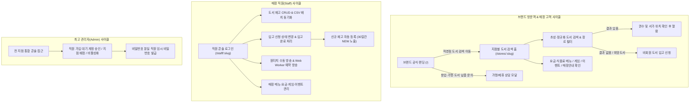

# 카툰플러스 (CartoonPlus) 제품 요구사항 정의서 (PRD)

> **문서 상태**: 표준 기준 문서 (Single Source of Truth)  
> **기준 스펙**: 브랜드 공식 랜딩(`/`) + 3개 직영점(`snu`, `jamsil`, `hongdae`) 고객 포털 및 직원 콘솔 운영 (ADR-0001 ~ ADR-0010)  
> **최종 갱신일**: 2026-11-11

---

## 1. 프로젝트 개요 및 배경

### 1.1 프로젝트 목적

- 브랜드 공식 소개 및 가맹 상담 채널(`/`), 지점별 고객 도서 검색·매장 안내 포털(`/stores/:storeSlug`), 매장 직원 현장 운영 콘솔(`/staff/:storeSlug`)의 단일 웹 플랫폼 통합.
- 도서 검색 정확도 향상, 매장 엔터테인먼트·이벤트 정보 신뢰성 확보, 직원 반복 업무(재고 동기화, 안내 방송, 입고 신청 처리) 자동화.
- **월 고정 서버 운영비 \$0(도메인 실비 제외) 구조로 고객 탐색 경험과 매장 운영 효율을 개선함.**

### 1.2 배경 및 문제 정의 (As-Is)

- **고정 비용 발생**: 기존 아임웹 호스팅 및 Caspio DB 유료 구독으로 연 30만 원 상당 고정비 지출 발생.
- **모바일·PC 레이아웃 파손**: 반응형 미흡으로 모바일 접속 시 가로 스크롤 및 검색 컨트롤 잘림 발생.
- **검색 실패율 증가**: 공백 무시 및 초성 검색 미지원으로 `'체인소맨'` 입력 시 `'체인소 맨'`이 검색되지 않는 0건 결과 발생.
- **희망도서 누락**: 수기 메모·구두 접수로 인한 고객 신청 도서 분실 및 발주 상태 추적 불가.
- **방송 업무 비효율**: 음료 픽업·마감·신분증 검사 시 외부 번역기 TTS에 텍스트를 매번 수동 입력하여 송출함.
- **엔터테인먼트·이벤트 관리 부재**: 실물 미확인 게임 노출 및 종료된 과거 이벤트 방치.

### 1.3 해결 방안 (To-Be)

- **Cloudflare Pages + Supabase 서버리스 아키텍처**: 월 고정 운영비 \$0 인프라 구축 및 23개 공개 라우트 SSG 정적 사전 생성으로 SEO·초기 로딩 속도 개선.
- **브랜드 랜딩과 지점 포털 이원화**: 루트(`/`)는 브랜드 소개·중고만화책 쇼핑몰(`bookis.store`)·3J 자동화·가맹 상담 전용 랜딩으로 구성하고, `/books` 및 `/stores/:storeSlug`는 매장 방문 고객용 도서 검색 홈으로 분리함.
- **초성 및 공백 무시 고속 검색**: `WeakMap` 사전 인덱싱과 1단계 장르 `Set` 필터링을 결합하여 도서명·작가명·초성(`ㅊㅇㅅㅁ`) 부분 일치 매칭 및 서가 위치 즉시 확인 지원.
- **비회원 도서 입고 신청 파이프라인**: 개인정보 미수집 간편 신청 및 직원의 `접수(received)` ➔ `주문 완료(ordered)` ➔ `입고 완료(completed)` ➔ `신규 재고 등록` 원클릭 연계 처리.
- **무중단 전역 안내 방송 스케줄러**: 6종 기본 정적 음원 및 지점별 업로드 프리셋, 비로그인 카운터 PC Web Worker 스케줄러(ADR-0010), 7일 롤링 실행 이력 관리.
- **검증 기반 게임 & 이벤트 자동 만료**: 현장 검수 완료 지점 한정 게임 목록 노출(미검증 지점은 '점검 중' 안내), 이벤트 종료일 익일 자동 숨김 처리.
- **지점 격리형 직원 승인 체계**: 이메일 미수집(이름, 소속 지점, 로그인 ID, 비밀번호, 휴대폰 뒷 4자리) 기반 관리자 승인제 및 RLS 지점 권한 격리 운영.

---

## 2. 사용자 역할 및 서비스 사이클

### 2.1 사용자 역할 정의

| 역할                          | 진입 경로                           | 주요 권한 및 수행 활동                                                                                                                       |
| :---------------------------- | :---------------------------------- | :------------------------------------------------------------------------------------------------------------------------------------------- |
| **브랜드 방문객 / 예비 점주** | `/`                                 | 카툰플러스 공간 철학, 중고만화책 쇼핑몰(`bookis.store`), 3J 자동화 시스템 확인, 직영점 포털 이동, 가맹·제휴 상담 문의                        |
| **매장 이용 고객 (Guest)**    | `/books` `/stores/:storeSlug/*` | 별도 가입/로그인 없이 지점별 도서 검색, 서가 위치 확인, 신간 조회, 비회원 도서 입고 신청, 메뉴·요금·게임·이벤트·매장정보 열람                |
| **매장 직원 (Staff)**         | `/staff/:storeSlug/*`               | 승인 계정 로그인 후 소속 지점의 도서 재고 등록/수정/삭제, CSV 일괄 동기화, 입고 신청 처리, 매장 콘텐츠·이벤트 관리, 안내 방송 수동/예약 제어 |
| **시스템 관리자 (Admin)**     | `/staff/:storeSlug/*`               | 전 지점 전환 및 통합 관리, 직원 가입 승인(`approved`)/비활성화(`deactivated`), 지점 배정, 비밀번호 분실 시 임시 비밀번호 발급                |

### 2.2 사용자 시나리오 흐름도

---

## 3. 단계별 구축 현황 및 로드맵

### 3.1 구축 완료 범위 (1단계 MVP & 2단계 다지점·브랜드 확장)

- **브랜드 공식 랜딩 (`/`)**:
  - 카툰플러스 만화카페 공간 경험, 도서 큐레이션 시스템, 직영점 쇼케이스, 중고만화책 온라인 쇼핑몰(`bookis.store`) 연계, 3J 무인·자동화 기술 소개, 가맹/제휴 상담 모달.
- **공개 운영 직영점 (3개 지점)**: 서울대입구역점(`snu`), 잠실점(`jamsil`), 홍대점(`hongdae`).
  - `/stores/:storeSlug/*` 지점 스코프 라우팅 및 레거시 경로 호환 리다이렉트 지원.
  - Node.js 빌드 후처리 스크립트(`scripts/generate-ssg.js`)를 통한 **23개 공개 라우트 정적 HTML 사전 생성**.
- **고객 포털**:
  - 도서 검색 홈: 공백 무시·초성 검색, 11대 표준 장르 필터, 텍스트 전용 카드, 30일 신간(`[NEW]`) 배지, 페이지당 18개 페이지네이션.
  - 비회원 도서 입고 신청 모달 및 전용 페이지(`/book-request`, `/stores/:storeSlug/book-request`).
  - 지점별 엔터테인먼트 카탈로그(`/games`), 진행 중 이벤트(`/events`), 통합 F&B 메뉴 및 선·후불 요금제(`/menu`), 매장 소개(`/about`) 및 오시는 길·시설 안내(`/info`).
- **직원/관리자 콘솔**:
  - 단일 레이아웃(`<Outlet />`) 기반 지점 스코프 관리 화면(`/staff/:storeSlug/*`).
  - 운영 대시보드(`dashboard`), 도서 재고 및 CSV 배치 가져오기(`inventory`), 입고 신청 처리(`requests`), 안내 방송 및 전역 스케줄러(`broadcast`), 게임 관리(`games`), 이벤트 관리(`events`), 매장 정보·메뉴 관리(`content`), 직원 계정 관리(`accounts`).

### 3.2 향후 로드맵 (3단계 매장 운영 고도화)

- 매장 평면도(Floor Map) 기반 서가 위치 핀포인트 시각화.
- 직원 디지털 출퇴근 체크(근태 관리).
- 룸·소굴방 실시간 이용 현황 연동.

---

## 4. UI/UX 디자인 시스템 기준

| 구분                | 브랜드 공식 랜딩 (`/`)                                       | 고객 포털 (`/stores/:slug/*`) & 직원 콘솔 (`/staff/*`)                 |
| :------------------ | :----------------------------------------------------------- | :--------------------------------------------------------------------- |
| **디자인 테마**     | 에디토리얼 다크 & 골드 (`#0A0A0C`, `#F5C518`)                | 카툰플러스 옐로우(`#FED943`), 딥 차콜(`#1E1E1E`), 웜 화이트(`#FFFEFA`) |
| **타이포그래피**    | `Pretendard Variable`, `Space Grotesk`, `JetBrains Mono`     | `Pretendard Variable`, `Plus Jakarta Sans` (비차단 비동기 웹폰트 로딩) |
| **스타일 아키텍처** | 전용 스타일시트 (`src/features/brand/brandLanding.css`)      | 공통 시맨틱 CSS 변수 체계 (`src/styles.css`)                           |
| **모바일 반응형**   | 스티키 글래스 헤더 및 모바일 드로어 메뉴                     | 가로 스크롤 없는 반응형 그리드 및 모바일 하단 고정 탭 바               |
| **접근성 지원**     | `prefers-reduced-motion` 애니메이션 제어 및 키보드 포커스 링 | 시맨틱 랜드마크(`header`, `main`, `nav`), `aria-live` 상태 알림        |

---

## 5. 인프라 비용 및 성능 지표

### 5.1 월간 인프라 운영비 산정

| 항목                               | 무료 제공 한도 (Free Tier)        | 카툰플러스 실제 사용량                     | 판정                                       |
| :--------------------------------- | :-------------------------------- | :----------------------------------------- | :----------------------------------------- |
| **DB 용량 (Supabase)**             | 500 MB                            | 약 33 MB (3개 지점 도서 약 4.5만 권)       | 여유                                       |
| **API 트래픽 (Supabase)**          | 5 GB / 월                         | 약 1.2 GB / 월 (SWR 인메모리 캐시 적용)    | 여유                                       |
| **정적 호스팅 (Cloudflare Pages)** | 정적 에셋 요청·대역폭 무제한 무료 | Vite 청크 분리 번들 + 23개 SSG 라우트 배포 | \$0 유지                                   |
| **총 고정 서버 운영비**            | -                                 | 프로덕션 상시 가동 중                      | **월 0원 (\$0 / month, 도메인 실비 제외)** |

### 5.2 핵심 성능 및 품질 지표

- **초기 엔트리 JS 번들 크기**: Rollup `manualChunks` 분리(`vendor-react`, `supabase`, `brand-landing`, `customer-pages`)를 통해 메인 엔트리 청크를 **31.76 kB (gzip 10.67 kB)**로 경량화함.
- **도서 검색 응답 속도**: 1.5만 권(지점당) 데이터 기준 `WeakMap` 사전 인덱싱 및 단일 패스 매칭으로 키 입력 후 **16ms(1프레임) 이내** 필터링 완료.
- **자동화 테스트 커버리지**: Vitest 기반 **25개 테스트 스위트, 141개 단위·통합 테스트** 통과 유지.
