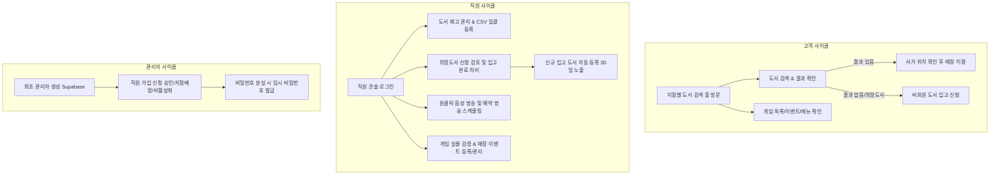

# 카툰플러스 (CartoonPlus Cafe) 제품 요구사항 정의서 (PRD)

> **문서 상태**: 표준 기준 문서 (Single Source of Truth)  
> **기준 스펙**: 서울대입구역점(`snu`), 잠실점(`jamsil`), 홍대점(`hongdae`) 3개 직영 지점 전면 운영 전환 및 안정화 완료 (ADR-0001 ~ ADR-0010)  
> **최종 갱신일**: 2026-10-06

---

## 🎯 1. 프로젝트 개요 및 배경

### 1.1 프로젝트 목적

- 도서 검색 정확도 개선, 매장 엔터테인먼트/이벤트 신뢰성 제공, 직원 반복 업무(도서 등록, 안내 방송, 입고 신청) 자동화.
- **월 고정 운영비 $0(도메인 실비 제외)로 고객 경험과 매장 운영 효율을 개선하는 반응형 만화카페 플랫폼 구축**.

### 1.2 배경 및 문제 정의 (As-Is)

- **고정 비용 발생**: 아임웹 호스팅 + Caspio DB 구독으로 연 30만 원 상당 고정비 지출.
- **모바일/PC 레이아웃 오류**: 반응형 미흡으로 모바일 접속 시 가로 스크롤 및 컨트롤 잘림 발생.
- **검색 실패율 증가**: 공백 무시 및 초성 검색 미지원으로 `체인소맨` 검색 시 0건 결과 발생.
- **희망도서 누락**: 수기 메모/구두 접수로 인한 고객 신청 도서 분실 및 발주 추적 불가.
- **방송 업무 비효율**: 음료 픽업/마감/신분증 검사 시 번역기 텍스트 수동 입력 후 송출.
- **엔터테인먼트 관리 부재**: 실물 미확인 게임 노출 및 만료 이벤트 방치.

### 1.3 해결 방안 (To-Be)

- **Cloudflare Pages + Supabase**: 월 고정 운영비 $0 서버리스 인프라 구축 및 SSG 정적 사전 렌더링을 통한 SEO/성능 최적화.
- **공백 무시 & 초성 정규화 검색**: 도서명, 작가명, 한글 초성(`ㅊㅇㅅㅁ`) 부분 일치 매칭 및 도서명-권수-서가위치 분리 노출.
- **비회원 도서 입고 신청 채널**: 고객 개인정보 미수집 간편 신청 지원 및 직원 접수/주문/입고완료/도서등록 일괄 연계 처리.
- **원클릭 & 예약 안내 방송**: 6종 정적 음원 및 업로드 음성 프리셋, 비로그인 전역 스케줄러(ADR-0010), 7일 롤링 실행 이력 관리.
- **검증 기반 게임 & 이벤트 자동 만료**: 실물 확인 게임 한정 노출(미검증 시 '점검 중' 표시), 이벤트 종료일 익일 자동 숨김.
- **안전한 직원 승인 체계**: 이메일 미수집(이름, 희망지점, 로그인ID, 비밀번호, 휴대폰 뒷4자리) 기반 관리자 승인제 운영.

---

## 👥 2. 사용자 및 서비스 사이클

### 2.1 사용자 역할 정의

1. **고객 (Guest / 비회원)**
   - 별도 가입/로그인 없이 전체 공개 서비스(지점별 도서 검색 홈, 매장 소개, 게임 목록, 이벤트, 메뉴/요금제, 도서 신청) 이용.
2. **매장 직원 (Staff)**
   - 관리자 승인 계정 로그인 후 소속 지점 도서 재고 관리, CSV 일괄 등록, 입고 신청 처리, 게임 검증, 이벤트 관리, 방송 송출 및 예약 관리 수행.
3. **점주 / 시스템 관리자 (Admin)**
   - Staff 권한 포함, 전 지점 전환 관리, 직원 가입 승인/반려, 계정 비활성화, 임시 비밀번호 발급 총괄.

### 2.2 사용자 시나리오 사이클

---

## 🚀 3. 단계별 구축 현황

### 1단계 (MVP) & 2단계 (다지점 공개 운영) - _운영 전환 완료_

- **공개 운영 지점**: 서울대입구역점(`snu`), 잠실점(`jamsil`), 홍대점(`hongdae`) 3개 직영 지점 전면 가동.
  - `/stores/:slug` 및 기본 경로 호환 라우팅 지원.
  - 정적 사전 빌드(SSG)를 통한 20개 지점별/공개 페이지 정적 HTML 사전 렌더링.
- **고객 포털**:
  - 도서 검색 중심 홈 (공백 무시, 초성 검색, 텍스트 전용 카드, 30일 신간 배지).
  - 도서 입고 신청 모달 및 독립 라우트 (`/book-request`).
  - 지점별 엔터테인먼트 카탈로그 (실물 검증 게임 노출, 미검증 시 점검 중 표시).
  - 지점별 매장 이벤트 (진행 중 이벤트 노출, 종료일 익일 자동 숨김).
  - 통합 F&B 메뉴판 및 선/후불 이용 요금제 안내 (`store_content` JSONB 기반).
  - 지점별 매장 안내 (영업시간, 주소, 전화번호, 주차 정보).
- **직원/관리자 콘솔**:
  - 지점 컨텍스트 기반 운영 대시보드 (`/staff/dashboard`).
  - 소속 지점 지정 직원 가입 신청/승인/비활성화 (`/staff/accounts`).
  - 도서 재고 단건 등록/수정/영구삭제 및 지점별 CSV 일괄 가져오기 (`/staff/inventory`).
  - 입고 신청 접수 ➔ 주문완료 ➔ 입고완료 ➔ 신규 재고 등록 연계 (`/staff/requests`).
  - 매장 안내 방송 (6종 정적 음원 및 업로드 프리셋, 전역 스케줄러, 7일 롤링 실행 이력) (`/staff/broadcast`).
  - 게임 실물 검증 (`/staff/games`) 및 이벤트 등록/관리 (`/staff/events`).
  - 지점별 메뉴 및 매장 시설 정보 인라인 편집 (`/staff/content`).

### 3단계 (매장 운영 자동화) - _향후 로드맵_

- 매장 평면도(Floor Map) 기반 서가 위치 핀포인트 시각화.
- 카카오/네이버 지도 길찾기 API 연동.
- 직원 디지털 출석 체크(근태 관리).
- 룸/좌석 실시간 이용 현황 연동.

---

## 📱 4. UI/UX 디자인 시스템 가이드

- **컬러 시스템**: 카툰플러스 옐로우(`Brand Yellow: #FED943`), 딥 차콜(`Deep Charcoal: #1E1E1E`), 서브 웜그레이.
- **컴포넌트 룩앤필**: 라운디드 카드(`rounded-2xl`), 시각적 위계가 명확한 텍스트 카드.
- **아이콘 시스템**: 일관된 선형(Linear) SVG 아이콘 한정 사용 (장식성 이모지/3D 스티커 배제).
- **에셋 활용**: 공식 승인 마스코트 10종 및 매장 실사 사진 정품 에셋만 활용.
- **모바일 반응형**: 가로 스크롤 없는 하단 Sticky 바 및 탭 네비게이션 적용.
- **화면 구조**: 도서검색(홈), 매장소개, 즐길거리, 메뉴·요금, 이벤트, 매장안내 기본 탐색 체계.
- **운영 항목 삭제**: 재고, 게임, 이벤트, 예약 방송 등 운영 항목 삭제 시 영구 삭제 처리 (복구함 미지원).
- **웹 접근성**: `prefers-reduced-motion` 지원을 통한 애니메이션 제어.

---

## 📚 5. 상세 기능 명세 (Functional Specifications)

### 5.1 도서 검색 엔진 (Book Search)

- **공백 무시(Whitespace Normalization)**: 검색어/도서명 공백 및 특수문자 제거 정규화 비교 (`체인소 맨` = `체인소맨`).
- **한글 초성 검색(Initial Consonant Search)**: 자음 검색어 입력 시 초성 인덱스 매칭 (`ㅊㅇㅅㅁ` → `체인소 맨`).
- **무효 쿼리 차단**: 공백/특수문자 단독 쿼리 시 0건 결과 반환 처리.
- **텍스트 전용 카드(Text-Only)**: 표지 이미지 로딩 없이 도서명, 작가명, 장르 배지, 보유 권수, 서가 위치 노출.
- **신규 입고 도서(New Arrival)**: 최초 등록일 기준 30일간 `[NEW]` 배지 및 신간 탭 노출.
- **검색 결과 없음**: 도서 입고 신청 모달 즉시 호출 CTA 제공.

### 5.2 도서 입고 신청 (Book Request)

- **고객 신청 폼**: 신청 도서명(필수), 작가/출판사(선택), 희망 권수(선택), 손님 한마디(선택) (개인정보 미수집).
- **직원 처리 라이프사이클**: `접수(PENDING)` ➔ `주문 완료(ORDERED)` ➔ `입고 완료(COMPLETED)` / `입고 불가(REJECTED)` 4단계 관리.

### 5.3 도서 재고 관리 & CSV Import (Inventory)

- **재고 등록/수정**: 도서명, 작가, 장르, 보유 권수, 서가 위치, 관리자 메모 관리.
- **CSV 안전 가져오기(Safe Import)**:
  - 3개 지점(서울대입구역, 잠실, 홍대) CSV 포맷 자동 감지/파싱.
  - `도서명 + 작가명` 기준 매칭 시 권수/서가 갱신, 미매칭 시 신규 추가, 기존 재고 안전 보존.
- **영구 삭제**: 소속 지점 재고 한정 영구 삭제 처리, 공통 도서 메타데이터 및 타 지점 재고 보존.

### 5.4 매장 안내 방송 (Broadcast)

- **정적 음원 프리셋 (6종)**: 음료 픽업, 기본 정돈, 만석 자리이동 제한, 소음 주의, 신분증 검사, 마감 안내 음원 제공.
- **커스텀 음성 파일 업로드**: 지점별 3MB 이하 커스텀 음성 파일 업로드 및 프리셋 등록 지원.
- **비로그인 전역 예약 스케줄러 (ADR-0010)**:
  - 카운터 PC 비로그인 상태 웹 브라우저 실행 시 예약 방송 자동 송출.
  - 매일(daily), 요일별(weekly), 1회성(once) 스케줄 지원.
  - 지점별 Lease 기반 중복 송출 방지 및 실행 이력 7일 롤링 보존.

### 5.5 엔터테인먼트 & 매장 이벤트

- **게임 카탈로그**: 실물 검증(`is_verified = TRUE`) 타이틀 한정 노출, 미검증 시 '점검 중' 표시.
- **매장 이벤트**: 이벤트 등록, 종료일 익일 자정 자동 숨김 처리, 과거 이벤트 복사(Draft) 지원.

### 5.6 직원 계정 및 관리자 인증 (Auth)

- **숨은 직원 진입**: 로고 2초 길게 누르기로 `/staff` 진입.
- **가입 및 승인**: 이름, 희망지점, 로그인ID, 비밀번호, 휴대폰 뒷4자리 입력 신청 ➔ 관리자 승인제 운영.
- **임시 비밀번호**: 비밀번호 분실 시 관리자 임시 비밀번호 발급.

---

## 💰 6. 인프라 및 운영비 산정

| 항목                               | 무료 제공 한도           | 카툰플러스 실제/예상치              | 판정                                      |
| :--------------------------------- | :----------------------- | :---------------------------------- | :---------------------------------------- |
| **DB 용량 (Supabase)**             | **500 MB**               | 약 33 MB (3개 지점 도서 4만~5만 권) | **여유**                                  |
| **API 트래픽 (Supabase)**          | **5 GB / 월**            | 약 1.5 GB / 월 (월 100만 회 조회)   | **초여유**                                |
| **정적 호스팅 (Cloudflare Pages)** | 정적 자산 요청·전송 무료 | React + SSG 20개 라우트 정적 배포   | **Free 유지**                             |
| **총 고정 운영비**                 | -                        | 프로덕션 운영 중                    | **월 0원 ($0 / month), 도메인 실비 제외** |

---

## 📊 7. 성공 지표 (KPI)

1. **검색 실패율**: 공백/초성 미지원으로 인한 0건 검색 비율 95% 이상 감소.
2. **카운터 도서 위치 문의**: 손님 직접 서가 탐색을 통한 대면 문의 70% 감소.
3. **희망도서 처리율**: 접수 희망도서의 100% 전산화 및 발주 추적.
4. **방송 송출 편의성**: 번역기 타이핑(1분) ➔ 원클릭(1초) 단축 및 전역 스케줄 자동화.
5. **고정비 절감**: 호스팅/Caspio 해지를 통한 연 30만 원 상당 고정비 100% 절감.
